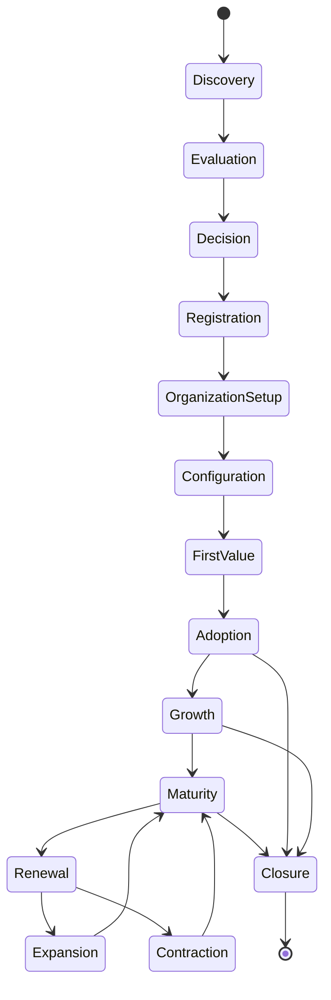

# Customer Lifecycle and Onboarding Specification

**Document ID:** SAAS-14.1  
**Stage:** 14 — User Onboarding, Organization Setup, Tenant Provisioning, Subscriptions, Billing, and SaaS Administration  
**Status:** Recorded  
**Last Updated:** 2026-01-29

---

## 1. Overview

This document defines the complete customer lifecycle from initial access through ongoing use to eventual account closure. It specifies the onboarding experience, organization setup, and the journey customers take to achieve first business value.

**Key Principles:**
- Concise, guided onboarding (not intimidating forms)
- Progressive disclosure (essential first, advanced later)
- Support for unlisted industries
- Clear path to first business value
- Distinguish essential setup from optional configuration
- Respect user time and context

---

## 2. Customer Lifecycle Stages

### 2.1 Lifecycle Overview

```
Discovery → Registration → Organization Creation → Configuration → 
First Value → Ongoing Use → Growth → Maturity → [Closure]
```

### 2.2 Lifecycle States

**Pre-Onboarding:**
- **Discovery:** User learns about platform
- **Evaluation:** User explores features, pricing
- **Decision:** User decides to try or purchase

**Onboarding:**
- **Registration:** User creates account
- **Organization Setup:** User creates/joins organization
- **Configuration:** User configures business settings
- **First Value:** User completes first meaningful workflow

**Active Use:**
- **Adoption:** Team begins using platform
- **Growth:** Usage expands, more features adopted
- **Maturity:** Platform is core to business operations

**Lifecycle Management:**
- **Renewal:** Subscription renewed
- **Expansion:** Plan upgraded, more users added
- **Contraction:** Plan downgraded, users removed
- **Closure:** Organization closed, data exported/deleted

### 2.3 State Transitions



---

## 3. Registration and Account Creation

### 3.1 Registration Entry Points

**Entry Point 1: Marketing Website**
- User clicks "Get Started" or "Sign Up"
- Directed to registration page
- Minimal friction, clear value proposition

**Entry Point 2: Invitation Email**
- User receives invitation from existing organization
- Clicks invitation link
- Directed to accept invitation flow
- Organization context pre-established

**Entry Point 3: Direct Login**
- Existing user returns to platform
- Directed to login page
- Can switch between organizations

### 3.2 Registration Flow

**Step 1: Account Creation**
```
Email Address → Password → First Name → Last Name → Create Account
```

**Required Information:**
- Email address (unique, verified)
- Password (meets complexity requirements)
- First name
- Last name

**Optional Information:**
- Phone number
- Company name (if creating organization)
- Role/title

**Validation:**
- Email format validation
- Email uniqueness check
- Password strength validation
- Name length validation

**Step 2: Email Verification**
```
Send Verification Email → User Clicks Link → Email Verified
```

**Verification Email:**
- Clear subject line
- Verification link with token
- Expiration time (24 hours)
- Support contact information

**Step 3: Initial Setup Choice**
```
Create New Organization OR Join Existing Organization
```

**Create New Organization:**
- User becomes organization owner
- Proceeds to organization setup
- Full administrative control

**Join Existing Organization:**
- User accepts invitation
- Assigned role by inviter
- Limited to organization scope

### 3.3 Account Creation Scenarios

**Scenario 1: New User, New Organization**
1. User registers with email/password
2. Verifies email
3. Chooses "Create New Organization"
4. Enters organization details
5. Becomes organization owner
6. Proceeds to configuration

**Scenario 2: New User, Existing Organization**
1. User receives invitation email
2. Clicks invitation link
3. Registers account (if new) or logs in (if existing)
4. Accepts invitation
5. Assigned role by organization
6. Gains access to organization

**Scenario 3: Existing User, New Organization**
1. User logs in to existing account
2. Chooses "Create New Organization"
3. Enters organization details
4. Becomes organization owner
5. Can switch between organizations

**Scenario 4: Existing User, Existing Organization**
1. User receives invitation email
2. Clicks invitation link
3. Logs in to existing account
4. Accepts invitation
5. Assigned role by organization
6. Can switch between organizations

---

## 4. Organization Creation and Setup

### 4.1 Organization Creation Flow

**Step 1: Basic Information**
```
Organization Name → Industry → Business Description → Continue
```

**Required Fields:**
- Organization name (unique within platform)
- Industry selection (from catalogue or "Other")
- Business description (if "Other" selected)

**Optional Fields:**
- Organization logo
- Website URL
- Company size (employee range)

**Step 2: Regional Settings**
```
Country → Time Zone → Currency → Language → Continue
```

**Required Fields:**
- Country (affects tax, compliance, currency)
- Time zone (affects scheduling, reporting)
- Currency (default for financial operations)
- Language (default UI language)

**Step 3: Initial Administrator**
```
Confirm Owner → Set Up Admin Account → Continue
```

**Required Actions:**
- Confirm user is organization owner
- Verify admin account details
- Set up initial admin preferences

**Step 4: Module Selection**
```
Select Modules → Configure Basic Settings → Continue
```

**Required Actions:**
- Select initial modules (based on industry recommendations)
- Configure basic module settings
- Can be modified later

**Step 5: Team Invitation (Optional)**
```
Invite Team Members → Assign Roles → Continue
```

**Optional Actions:**
- Invite team members via email
- Assign initial roles
- Can be done later

**Step 6: First Workflow**
```
Complete First Workflow → Achieve First Value → Continue
```

**Required Actions:**
- Guide user through first meaningful workflow
- Example: Create first lead, log first activity
- Celebrate first value achievement

### 4.2 Organization Setup Behavior

**New Organizations:**
- Full setup flow (Steps 1-6)
- Owner has full administrative control
- Default configuration based on industry
- Can customize all settings

**Existing Organizations:**
- Setup already complete
- New members join via invitation
- Configuration managed by admins
- Settings can be modified by authorized users

**Multi-Branch Organizations:**
- Initial setup creates primary branch
- Additional branches can be added later
- Each branch can have own settings
- Organization-level settings apply to all branches

**Multi-Region Organizations:**
- Initial setup selects primary region
- Additional regions can be added later
- Currency and tax settings per region
- Compliance requirements per region

**Unlisted Industry Organizations:**
- User selects "Other — my industry is not listed"
- User provides business description
- Platform uses universal core capabilities
- User configures custom terminology
- No industry-specific defaults applied

**Incomplete Setup Organizations:**
- Organization created but setup not completed
- Limited functionality available
- Prompts to complete setup
- Can resume setup at any time

### 4.3 Organization Configuration

**Post-Setup Configuration:**
- Organization details (name, logo, description)
- Regional settings (country, timezone, currency, language)
- Industry configuration (terminology, workflows, KPIs)
- Module settings (per-module configuration)
- User management (invitations, roles, permissions)
- Integration setup (external systems, APIs)
- Notification preferences (email, in-app, SMS)

**Configuration Management:**
- Changes logged in audit trail
- Some changes require approval
- Some changes affect all users
- Some changes are user-specific

---

## 5. First Value Achievement

### 5.1 First Value Definition

**First Value:** The first meaningful business outcome achieved using the platform

**Examples by Module:**
- **CRM:** First lead created and qualified
- **Sales:** First opportunity moved through pipeline
- **Inventory:** First product added and stock tracked
- **Finance:** First invoice created and sent
- **Projects:** First task created and completed
- **Support:** First case created and resolved

### 5.2 First Value Guidance

**Guided Workflow:**
1. Identify user's primary business need
2. Recommend relevant first workflow
3. Provide step-by-step guidance
4. Celebrate achievement
5. Suggest next steps

**Contextual Help:**
- Inline tooltips for first-time actions
- Video tutorials for complex workflows
- Documentation links for detailed information
- Support chat for immediate assistance

**Success Metrics:**
- Time to first value (target: < 30 minutes)
- First value completion rate (target: > 80%)
- User satisfaction with onboarding (target: > 4.0/5.0)

### 5.3 Onboarding Completion Signals

**Completion Indicators:**
- Organization setup complete
- At least one user invited
- First workflow completed
- Basic configuration done

**Stuck Detection:**
- No activity for 7 days after registration
- Setup incomplete after 3 days
- No first value after 14 days
- Low engagement metrics

**Re-engagement:**
- Email reminders for incomplete setup
- In-app prompts for next steps
- Support outreach for stuck users
- Educational content for struggling users

---

## 6. Ongoing Use and Growth

### 6.1 Adoption Phase

**Activities:**
- Team members join organization
- Users complete training
- Workflows established
- Data populated

**Success Metrics:**
- User adoption rate (target: > 70% of invited users)
- Feature usage breadth (target: > 3 core features used)
- Data completeness (target: > 80% of required fields filled)

### 6.2 Growth Phase

**Activities:**
- More users added
- Additional modules activated
- Integrations configured
- Advanced features adopted

**Success Metrics:**
- User growth rate
- Module adoption rate
- Integration usage
- Feature depth

### 6.3 Maturity Phase

**Activities:**
- Platform core to operations
- Advanced analytics used
- AI features adopted
- Custom workflows created

**Success Metrics:**
- Daily active users
- Platform dependency
- Business impact metrics
- Retention rate

---

## 7. Lifecycle Management

### 7.1 Subscription Management

**Renewal:**
- Automatic renewal by default
- Renewal reminder 30 days before
- Easy renewal process
- Proration for mid-cycle changes

**Upgrade:**
- Plan upgrade available anytime
- Prorated billing for upgrade
- Immediate access to new features
- No data migration required

**Downgrade:**
- Plan downgrade available anytime
- Prorated credit for downgrade
- Access to new plan at next billing cycle
- Data preserved (no deletion)

**Cancellation:**
- Cancellation available anytime
- Access until end of billing period
- Data export available before closure
- No automatic data deletion

### 7.2 Organization Management

**Ownership Transfer:**
- Current owner initiates transfer
- New owner accepts transfer
- Full administrative control transferred
- Audit trail of transfer

**Organization Suspension:**
- Suspension by platform admin (for violations)
- Suspension by owner (temporary pause)
- Suspension due to payment failure
- Reactivation process defined

**Organization Closure:**
- Owner initiates closure
- Data export offered
- Confirmation required
- Data retained per policy
- Eventually deleted per retention policy

---

## 8. Onboarding UX Design

### 8.1 Onboarding Principles

**Concise:**
- Minimize required steps
- Skip optional steps by default
- Allow resumption later
- Respect user time

**Guided:**
- Clear next steps
- Contextual help
- Progress indicators
- Success celebrations

**Professional:**
- Clean, modern design
- Consistent with platform UI
- No unnecessary animations
- Clear information hierarchy

### 8.2 Onboarding Flow Design

**Progressive Disclosure:**
```
Essential Setup (Required)
  ↓
Basic Configuration (Recommended)
  ↓
Advanced Settings (Optional)
  ↓
Team Setup (Optional)
  ↓
First Workflow (Guided)
```

**Skip and Resume:**
- Users can skip optional steps
- Can resume skipped steps later
- Clear indication of what's skipped
- Easy access to skipped items

**Contextual Guidance:**
- Inline help for complex fields
- Tooltips for unfamiliar concepts
- Examples for data entry
- Links to detailed documentation

### 8.3 Empty States

**Empty State Design:**
- Clear explanation of what belongs here
- Call-to-action for first item
- Examples or templates
- Link to documentation

**No Fabricated Data:**
- Never show fake data as examples
- Clearly label demonstration data
- Provide option to clear demo data
- Explain real data requirements

---

## 9. Acceptance Criteria

### 9.1 Registration and Account

- [ ] Users can register with email/password
- [ ] Email verification works correctly
- [ ] Password requirements enforced
- [ ] Account creation logged
- [ ] Duplicate accounts prevented

### 9.2 Organization Setup

- [ ] Organizations can be created
- [ ] Industry selection works (including "Other")
- [ ] Regional settings configurable
- [ ] Module selection functional
- [ ] Setup can be resumed if interrupted

### 9.3 First Value

- [ ] Guided workflow for first value
- [ ] Contextual help available
- [ ] Success celebrated
- [ ] Next steps suggested
- [ ] Time to first value < 30 minutes

### 9.4 Ongoing Use

- [ ] Team invitation works
- [ ] Role assignment functional
- [ ] Configuration changes logged
- [ ] Subscription management available
- [ ] Organization lifecycle managed

### 9.5 UX Quality

- [ ] Onboarding is concise
- [ ] Guidance is contextual
- [ ] Empty states are helpful
- [ ] No fabricated data
- [ ] Professional appearance

---

## 10. References

- Stage 4: UI/UX Design (onboarding screens)
- Stage 5: Data Model (organization entities)
- Stage 7: Security Architecture (authentication)
- Stage 12: Deployment and Operations (user management)
- Stage 13: Product Strategy (MVP scope)

---

**Document Status:** Recorded  
**Next Review:** Before implementation  
**Owner:** Product Manager / UX Designer
