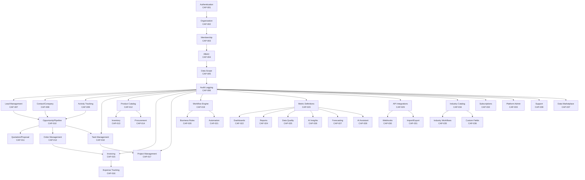

# Module Dependency and Release Sequence

**Document ID:** PROD-13.5  
**Stage:** 13 — Product Scope, MVP Boundaries, Feature Prioritization, and Phased Delivery  
**Status:** Recorded  
**Last Updated:** 2026-01-29

---

## 1. Overview

This document maps the dependencies between platform modules and defines the optimal release sequence. It ensures that each phase builds on a solid foundation and that dependencies are respected throughout the delivery process.

**Purpose:**
- Visualize module dependencies
- Identify critical path
- Detect circular dependencies
- Optimize release sequence
- Enable parallel development where possible

---

## 2. Module Dependency Map

### 2.1 Dependency Types

**Hard Dependencies:**
- Module B cannot function without Module A
- Must be built and released first
- Example: Authentication must exist before any protected features

**Soft Dependencies:**
- Module B works better with Module A, but can function without it
- Can be built in parallel, but integration requires Module A
- Example: Dashboards work better with metrics, but can show basic data

**Optional Dependencies:**
- Module B can optionally integrate with Module A
- Both can be built independently
- Example: AI insights can use metrics, but can also work with raw data

### 2.2 Core Module Dependencies



### 2.3 Dependency Matrix

| Module | Depends On | Blocks | Parallel Possible |
|--------|-----------|--------|-------------------|
| CAP-001: Authentication | None | All modules | No (foundation) |
| CAP-002: Organization | CAP-001 | CAP-003, CAP-004 | No |
| CAP-003: Membership | CAP-001, CAP-002 | CAP-004, CAP-005 | No |
| CAP-004: RBAC | CAP-001, CAP-002, CAP-003 | All business modules | No |
| CAP-005: Data Scope | CAP-004 | All business modules | No |
| CAP-006: Audit Logging | CAP-001, CAP-002 | All business modules | No |
| CAP-007: Lead Management | CAP-001-006 | CAP-010 | Yes (with CAP-008, 009) |
| CAP-008: Contact/Company | CAP-001-006 | CAP-010 | Yes (with CAP-007, 009) |
| CAP-009: Activity Tracking | CAP-001-006 | None | Yes (with CAP-007, 008) |
| CAP-010: Opportunity/Pipeline | CAP-007, CAP-008 | CAP-011, CAP-012 | No |
| CAP-011: Quotation/Proposal | CAP-010 | None | Yes |
| CAP-012: Product Catalog | CAP-001-006 | CAP-013, CAP-014 | Yes |
| CAP-013: Inventory | CAP-012 | None | Yes |
| CAP-014: Procurement | CAP-012, CAP-013 | None | No |
| CAP-015: Invoicing | CAP-010, CAP-012 | CAP-016 | No |
| CAP-016: Expense Tracking | CAP-015 | None | Yes |
| CAP-017: Project Management | CAP-018 | None | Yes |
| CAP-018: Task Management | CAP-001-006 | CAP-017 | Yes |
| CAP-019: Workflow Engine | CAP-001-006 | CAP-020, CAP-021 | No |
| CAP-020: Business Rules | CAP-019 | None | Yes |
| CAP-021: Automation | CAP-019, CAP-020 | None | No |
| CAP-022: Dashboards | CAP-023 | None | Yes |
| CAP-023: Metric Definitions | CAP-001-006 | CAP-022, CAP-024, CAP-025 | No |
| CAP-024: Reports | CAP-023 | None | Yes |
| CAP-025: Data Quality | CAP-023 | None | Yes |
| CAP-026: AI Insights | CAP-023, CAP-024 | None | Yes |
| CAP-027: Forecasting | CAP-023, CAP-026 | None | No |
| CAP-028: AI Assistant | CAP-023, CAP-026 | None | No |
| CAP-029: API Integrations | CAP-001-006 | CAP-030, CAP-031 | Yes |
| CAP-030: Webhooks | CAP-029 | None | Yes |
| CAP-031: Import/Export | CAP-029 | None | Yes |
| CAP-034: Industry Catalog | CAP-001-006 | CAP-035, CAP-036 | Yes |
| CAP-035: Industry Workflows | CAP-034, CAP-019 | None | No |
| CAP-036: Custom Fields | CAP-034 | None | Yes |
| CAP-032: Subscriptions | CAP-001-006 | None | Yes |
| CAP-033: Platform Admin | CAP-001-006 | None | Yes |
| CAP-039: Support | CAP-001-006 | None | Yes |
| CAP-037: Data Marketplace | CAP-001-006, CAP-023 | None | No |

---

## 3. Critical Path Analysis

### 3.1 Critical Path

The critical path is the longest sequence of dependent modules that determines the minimum project duration.

**Critical Path:**
```
CAP-001 (Authentication)
  → CAP-002 (Organization)
    → CAP-003 (Membership)
      → CAP-004 (RBAC)
        → CAP-005 (Data Scope)
          → CAP-006 (Audit Logging)
            → CAP-007 (Lead Management)
              → CAP-010 (Opportunity/Pipeline)
                → CAP-015 (Invoicing)
                  → CAP-023 (Metric Definitions)
                    → CAP-026 (AI Insights)
                      → CAP-027 (Forecasting)
```

**Critical Path Duration:** 6 + 8 + 8 + 12 + 10 + 12 = 56 weeks (14 months)

### 3.2 Parallel Paths

**Path A: CRM (Critical)**
- Duration: 6 + 8 = 14 weeks
- Modules: Foundation → CRM

**Path B: Inventory (Parallel)**
- Duration: 6 + 8 = 14 weeks
- Modules: Foundation → Product Catalog → Inventory
- Can start after Foundation, parallel with CRM

**Path C: Projects (Parallel)**
- Duration: 6 + 8 = 14 weeks
- Modules: Foundation → Task Management → Project Management
- Can start after Foundation, parallel with CRM

**Path D: BI (Sequential)**
- Duration: 6 + 8 + 10 = 24 weeks
- Modules: Foundation → CRM → Metrics → Dashboards
- Must wait for CRM data

**Path E: AI (Sequential)**
- Duration: 6 + 8 + 10 + 12 = 36 weeks
- Modules: Foundation → CRM → Metrics → AI Insights → Forecasting
- Must wait for BI foundation

### 3.3 Bottleneck Analysis

**Bottleneck 1: Foundation (Phase 1)**
- All modules depend on foundation
- Duration: 6 weeks
- Risk: High (delays everything)
- Mitigation: Prioritize foundation, allocate best resources

**Bottleneck 2: CRM (Phase 2)**
- BI and AI depend on CRM data
- Duration: 8 weeks
- Risk: Medium (delays BI and AI)
- Mitigation: Focus on core CRM features first

**Bottleneck 3: Metrics (Phase 5)**
- AI depends on metrics
- Duration: 10 weeks
- Risk: Medium (delays AI)
- Mitigation: Define core metrics early, iterate

---

## 4. Release Sequence

### 4.1 Optimal Release Sequence

Based on dependency analysis, the optimal release sequence is:

**Release 1: Foundation (Week 1-6)**
- CAP-001: Authentication
- CAP-002: Organization
- CAP-003: Membership
- CAP-004: RBAC
- CAP-005: Data Scope
- CAP-006: Audit Logging
- CAP-038: Monitoring (Basic)

**Release 2: Core CRM (Week 7-14)**
- CAP-007: Lead Management
- CAP-008: Contact/Company
- CAP-009: Activity Tracking
- CAP-010: Opportunity/Pipeline
- CAP-012: Product Catalog (Basic)
- CAP-018: Task Management
- CAP-022: Dashboards (Basic)

**Release 3: Inventory (Week 15-22)** [Parallel with Release 4]
- CAP-013: Inventory Management
- CAP-014: Procurement

**Release 4: Operational Workflows (Week 15-26)** [Parallel with Release 3]
- CAP-015: Invoicing (Basic)
- CAP-016: Expense Tracking
- CAP-017: Project Management
- CAP-019: Workflow Engine
- CAP-020: Business Rules
- CAP-021: Automation

**Release 5: BI & Analytics (Week 27-36)**
- CAP-023: Metric Definitions
- CAP-024: Reports
- CAP-025: Data Quality

**Release 6: AI/ML (Week 37-48)**
- CAP-026: AI Insights
- CAP-027: Forecasting
- CAP-028: AI Assistant

**Release 7: Integrations & Industry (Week 49-60)**
- CAP-029: API Integrations
- CAP-030: Webhooks
- CAP-031: Import/Export
- CAP-034: Industry Catalog
- CAP-035: Industry Workflows
- CAP-036: Custom Fields

**Release 8: SaaS Maturity (Week 61+)**
- CAP-032: Subscriptions
- CAP-033: Platform Admin
- CAP-039: Support
- CAP-037: Data Marketplace (Future)

### 4.2 Parallel Development Opportunities

**Parallel Group 1: After Foundation**
- CRM development (Release 2)
- Product Catalog development (for Release 3)
- Task Management development (for Release 4)

**Parallel Group 2: After CRM**
- Inventory development (Release 3)
- Operational Workflows development (Release 4)
- BI foundation (Release 5 prep)

**Parallel Group 3: After BI**
- AI development (Release 6)
- Integration design (Release 7 prep)
- Industry configuration design (Release 7 prep)

### 4.3 Integration Points

**Integration Point 1: Foundation → CRM**
- Week 6-7
- Verify authentication works with CRM
- Verify permissions work with CRM data
- Verify audit logging captures CRM actions

**Integration Point 2: CRM → Inventory**
- Week 14-15
- Verify product catalog integrates with inventory
- Verify sales orders can trigger inventory updates
- Verify inventory data appears in CRM

**Integration Point 3: CRM → Operational Workflows**
- Week 14-15
- Verify opportunities can trigger invoicing
- Verify tasks integrate with projects
- Verify workflows can automate CRM actions

**Integration Point 4: CRM → BI**
- Week 14-27
- Verify CRM data feeds into metrics
- Verify dashboards show CRM data
- Verify reports can analyze CRM data

**Integration Point 5: BI → AI**
- Week 36-37
- Verify metrics feed into AI models
- Verify AI can access BI data
- Verify AI insights appear in dashboards

---

## 5. Dependency Risks

### 5.1 High-Risk Dependencies

**Risk 1: Foundation delays block everything**
- **Impact:** Critical
- **Probability:** Medium
- **Mitigation:** Prioritize foundation, allocate best resources, extensive testing
- **Contingency:** Reduce foundation scope if needed

**Risk 2: CRM delays block BI and AI**
- **Impact:** High
- **Probability:** Medium
- **Mitigation:** Focus on core CRM features, parallel development where possible
- **Contingency:** Simplify CRM scope if needed

**Risk 3: Metrics delays block AI**
- **Impact:** High
- **Probability:** Low
- **Mitigation:** Define core metrics early, iterate on advanced metrics
- **Contingency:** Defer advanced metrics to later phase

### 5.2 Medium-Risk Dependencies

**Risk 1: Inventory and Operational Workflows compete for resources**
- **Impact:** Medium
- **Probability:** Medium
- **Mitigation:** Parallel development with separate teams
- **Contingency:** Sequence releases if resources limited

**Risk 2: Integration complexity underestimated**
- **Impact:** Medium
- **Probability:** Medium
- **Mitigation:** Start with simple integrations, add complexity gradually
- **Contingency:** Reduce integration scope

**Risk 3: Industry configuration complexity**
- **Impact:** Medium
- **Probability:** Low
- **Mitigation:** Start with universal foundation, add industry features gradually
- **Contingency:** Simplify industry configurations

### 5.3 Low-Risk Dependencies

**Risk 1: SaaS maturity features depend on product-market fit**
- **Impact:** Low
- **Probability:** Low
- **Mitigation:** Validate product-market fit before investing in SaaS features
- **Contingency:** Defer SaaS features if not needed

**Risk 2: Data marketplace depends on legal review**
- **Impact:** Low
- **Probability:** Low
- **Mitigation:** Start legal review early
- **Contingency:** Defer marketplace indefinitely

---

## 6. Dependency Management

### 6.1 Dependency Tracking

**Tools:**
- Dependency matrix (this document)
- Mermaid diagrams for visualization
- Project management tool (Jira, Linear, etc.)
- Architecture decision records (ADRs)

**Process:**
1. Identify dependencies during design
2. Document dependencies in this document
3. Track dependencies in project management tool
4. Review dependencies weekly
5. Update dependencies as design evolves

### 6.2 Dependency Validation

**Validation Points:**
- Design review: Validate dependencies are correct
- Development: Validate dependencies are implemented
- Integration testing: Validate dependencies work together
- Release: Validate all dependencies are satisfied

**Validation Criteria:**
- Hard dependencies: Must be complete before dependent module starts
- Soft dependencies: Should be complete before integration
- Optional dependencies: Can be deferred

### 6.3 Dependency Resolution

**Resolution Strategies:**
1. **Sequence:** Build dependencies first (preferred for hard dependencies)
2. **Parallel:** Build in parallel with integration points (for soft dependencies)
3. **Defer:** Defer dependent module (for optional dependencies)
4. **Simplify:** Reduce dependency complexity (if possible)

**Resolution Process:**
1. Identify dependency conflict
2. Assess impact (schedule, scope, quality)
3. Evaluate resolution strategies
4. Select best strategy
5. Update roadmap
6. Communicate changes

---

## 7. Release Dependencies

### 7.1 Release Readiness Criteria

Each release must satisfy these criteria before proceeding:

**Release 1 (Foundation):**
- [ ] All foundation modules complete
- [ ] Security testing passed
- [ ] Tenant isolation verified
- [ ] Performance targets met
- [ ] Documentation complete

**Release 2 (CRM):**
- [ ] All CRM modules complete
- [ ] Integration with foundation verified
- [ ] User acceptance testing passed
- [ ] Performance targets met
- [ ] Documentation complete

**Release 3 (Inventory):**
- [ ] All inventory modules complete
- [ ] Integration with CRM verified
- [ ] Data integrity verified
- [ ] Performance targets met
- [ ] Documentation complete

**Release 4 (Operational Workflows):**
- [ ] All workflow modules complete
- [ ] Integration with CRM verified
- [ ] Financial controls verified
- [ ] Performance targets met
- [ ] Documentation complete

**Release 5 (BI):**
- [ ] All BI modules complete
- [ ] Integration with CRM verified
- [ ] Metric accuracy verified
- [ ] Performance targets met
- [ ] Documentation complete

**Release 6 (AI):**
- [ ] All AI modules complete
- [ ] Integration with BI verified
- [ ] Model accuracy validated
- [ ] Performance targets met
- [ ] Documentation complete

**Release 7 (Integrations & Industry):**
- [ ] All integration modules complete
- [ ] External integrations tested
- [ ] Industry configurations validated
- [ ] Performance targets met
- [ ] Documentation complete

**Release 8 (SaaS Maturity):**
- [ ] All SaaS modules complete
- [ ] Subscription management working
- [ ] Platform administration working
- [ ] Performance targets met
- [ ] Documentation complete

### 7.2 Release Dependencies

**Release 2 depends on Release 1:**
- Authentication must work
- Organization must be configurable
- Permissions must be enforced
- Audit logging must capture events

**Release 3 depends on Release 2:**
- Product catalog must exist
- CRM data must be available
- Permissions must work for inventory

**Release 4 depends on Release 2:**
- CRM data must be available
- Opportunities must exist for invoicing
- Tasks must exist for projects

**Release 5 depends on Release 2:**
- CRM data must be available
- Business data must be stable
- Metrics must be definable

**Release 6 depends on Release 5:**
- Metrics must be defined
- Historical data must exist
- Data quality must be verified

**Release 7 depends on Release 2:**
- Core platform must be stable
- APIs must be defined
- Data models must be stable

**Release 8 depends on Release 2-7:**
- Platform must be mature
- Customer base must exist
- Product-market fit validated

---

## 8. Acceptance Criteria

### 8.1 Dependency Documentation

- [ ] All module dependencies identified
- [ ] Dependency types classified (hard, soft, optional)
- [ ] Dependency matrix complete
- [ ] Dependency diagram created
- [ ] Critical path identified
- [ ] Parallel opportunities identified

### 8.2 Release Sequence

- [ ] Release sequence defined
- [ ] Release dependencies documented
- [ ] Integration points identified
- [ ] Release readiness criteria defined
- [ ] Release schedule created

### 8.3 Risk Management

- [ ] Dependency risks identified
- [ ] Risk impact assessed
- [ ] Risk mitigation planned
- [ ] Risk contingency defined
- [ ] Risk monitoring process established

### 8.4 Dependency Management

- [ ] Dependency tracking tools selected
- [ ] Dependency validation process defined
- [ ] Dependency resolution process defined
- [ ] Dependency communication plan established

---

## 9. References

- Stage 2: System Architecture (module structure)
- Stage 5: Data Model (data dependencies)
- Stage 6: Business Workflows (workflow dependencies)
- Product Capability Catalog (PROD-13.1)
- MVP Scope and Acceptance Criteria (PROD-13.2)
- Feature Prioritization and Decision Matrix (PROD-13.3)
- Phased Product Delivery Roadmap (PROD-13.4)

---

**Document Status:** Recorded  
**Next Review:** Monthly roadmap review  
**Owner:** Product Manager / Engineering Lead  
**Approvers:** Executive Sponsor, Engineering Lead
