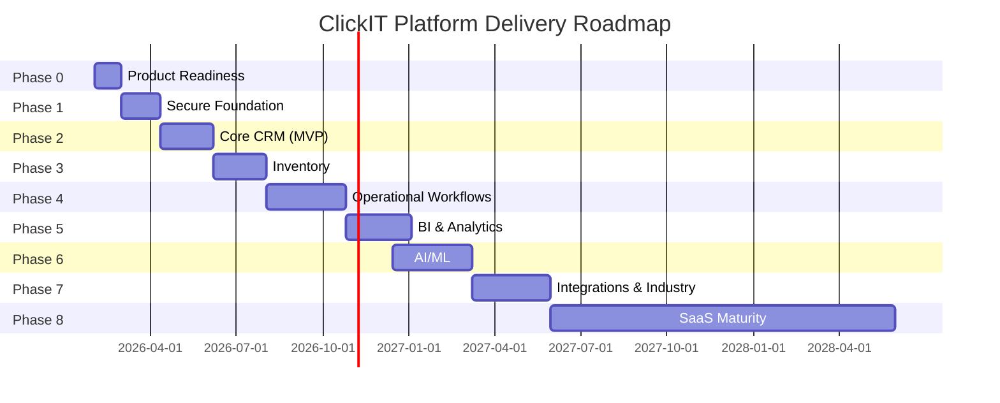

# Phased Product Delivery Roadmap

**Document ID:** PROD-13.4  
**Stage:** 13 — Product Scope, MVP Boundaries, Feature Prioritization, and Phased Delivery  
**Status:** Recorded  
**Last Updated:** 2026-01-29

---

## 1. Overview

This roadmap defines the phased delivery plan for the ClickIT platform, from MVP through maturity. Each phase builds on the previous phase, delivering incremental business value while managing risk and complexity.

**Roadmap Philosophy:**
- Deliver value early and often
- Validate assumptions before scaling
- Build foundation before features
- Defer high-risk capabilities until foundation is proven
- Remain flexible to adjust based on learning

---

## 2. Roadmap Summary

| Phase | Name | Duration | Key Deliverables | Exit Criteria |
|-------|------|----------|------------------|---------------|
| Phase 0 | Product Readiness | 4 weeks | Finalized specs, team setup, infrastructure | Ready to start development |
| Phase 1 | Secure Foundation | 6 weeks | Auth, tenancy, RBAC, audit, monitoring | Platform is secure and operational |
| Phase 2 | Core CRM | 8 weeks | Leads, contacts, opportunities, tasks, dashboards | MVP complete, ready for pilot |
| Phase 3 | Inventory | 8 weeks | Products, stock, procurement | Inventory management operational |
| Phase 4 | Operational Workflows | 12 weeks | Invoicing, expenses, projects, workflows | Business workflows automated |
| Phase 5 | BI & Analytics | 10 weeks | Metrics, reports, data quality | Insights and reporting available |
| Phase 6 | AI/ML | 12+ weeks | AI insights, forecasting, assistant | AI capabilities operational |
| Phase 7 | Integrations & Industry | 12 weeks | APIs, webhooks, industry config | Platform is extensible |
| Phase 8 | SaaS Maturity | Ongoing | Subscriptions, platform admin, marketplace | Platform is mature SaaS |

**Total Timeline:** 72+ weeks (18+ months) to full maturity

---

## 3. Phase 0: Product and Technical Readiness

### 3.1 Phase Objective

Establish the foundation for successful development by finalizing specifications, assembling the team, and setting up infrastructure.

### 3.2 Duration

**4 weeks** (pre-development)

### 3.3 Key Activities

**Week 1-2: Specification Finalization**
- Review and finalize all Stage 1-12 specifications
- Resolve open decisions (auth provider, cloud provider, etc.)
- Validate MVP scope with stakeholders
- Create detailed technical specifications for Phase 1-2

**Week 3: Team Assembly**
- Hire/assign development team
- Define roles and responsibilities
- Establish development processes
- Set up collaboration tools

**Week 4: Infrastructure Setup**
- Provision development environment
- Set up CI/CD pipeline
- Configure monitoring and logging
- Establish security baseline

### 3.4 Deliverables

- [ ] All specifications reviewed and approved
- [ ] Open decisions resolved
- [ ] MVP scope validated
- [ ] Technical specifications complete
- [ ] Team assembled and trained
- [ ] Development environment ready
- [ ] CI/CD pipeline functional
- [ ] Monitoring configured

### 3.5 Exit Criteria

- All specifications are finalized and approved
- Team is assembled and ready to develop
- Infrastructure is provisioned and configured
- Development processes are established
- Ready to start Phase 1 development

### 3.6 Risks and Mitigations

**Risk 1: Specification gaps discovered**
- **Mitigation:** Thorough review process, stakeholder validation
- **Contingency:** Extend Phase 0 if needed

**Risk 2: Team hiring delays**
- **Mitigation:** Start hiring early, consider contractors
- **Contingency:** Reduce initial scope if team is smaller

**Risk 3: Infrastructure setup issues**
- **Mitigation:** Use proven infrastructure patterns, early setup
- **Contingency:** Use managed services to reduce complexity

### 3.7 Dependencies

- **Input:** Stages 1-12 documentation (complete)
- **Output:** Phase 1 development can begin
- **External:** Cloud provider selection, auth provider selection

---

## 4. Phase 1: Secure Platform Foundation

### 4.1 Phase Objective

Build the secure, multi-tenant foundation that all other capabilities depend on. This phase establishes authentication, authorization, tenant isolation, and core platform infrastructure.

### 4.2 Duration

**6 weeks**

### 4.3 Key Activities

**Week 1-2: Authentication and Organization**
- Implement user authentication (CAP-001)
- Implement organization management (CAP-002)
- Implement membership and invitations (CAP-003)
- Set up database with RLS policies

**Week 3-4: Authorization and Audit**
- Implement RBAC (CAP-004)
- Implement data scope (CAP-005)
- Implement audit logging (CAP-006)
- Set up basic monitoring (CAP-038)

**Week 5-6: Testing and Validation**
- Comprehensive security testing
- Tenant isolation testing
- Performance testing
- Documentation and training

### 4.4 Deliverables

**CAP-001: User Authentication**
- Email/password login
- Multi-factor authentication (optional)
- Password reset and recovery
- Session management
- Brute force protection

**CAP-002: Organization and Tenant Management**
- Create organization
- Configure organization settings
- Manage branches and departments
- Suspend/activate organizations

**CAP-003: User Membership and Invitation**
- Invite users via email
- Accept/reject invitations
- Remove users from organization
- Transfer ownership

**CAP-004: Role-Based Access Control (RBAC)**
- System roles (Admin, Manager, User)
- Custom role creation
- Permission assignment
- Role-based UI visibility

**CAP-005: Data Scope and ABAC**
- Data scope rules (own, team, department, organization)
- Scope enforcement on all queries
- Scope override with approval

**CAP-006: Comprehensive Audit Logging**
- Authentication event logging
- Data modification logging
- Permission change logging
- Administrative action logging
- Audit log querying

**CAP-038: Monitoring and Alerting (Basic)**
- System health monitoring
- Error tracking
- Basic alerting
- Uptime monitoring

### 4.5 Exit Criteria

- [ ] Users can authenticate securely
- [ ] Organizations can be created and configured
- [ ] Users can be invited and assigned roles
- [ ] Permissions are enforced correctly
- [ ] Tenant isolation is verified
- [ ] Audit logs are complete
- [ ] System is monitored
- [ ] All security tests pass
- [ ] Performance meets targets
- [ ] Documentation is complete

### 4.6 Success Metrics

- Authentication success rate: > 99.9%
- Tenant isolation test pass rate: 100%
- Permission enforcement accuracy: 100%
- Audit log completeness: 100%
- System uptime: > 99.9%
- API response time: < 500ms (p95)

### 4.7 Risks and Mitigations

**Risk 1: Security vulnerabilities**
- **Mitigation:** Extensive security testing, penetration testing
- **Contingency:** Security review and remediation before proceeding

**Risk 2: Tenant isolation failures**
- **Mitigation:** Comprehensive tenant isolation tests, RLS validation
- **Contingency:** Architecture review and redesign if needed

**Risk 3: Performance issues**
- **Mitigation:** Performance testing, query optimization
- **Contingency:** Database optimization, caching

### 4.8 Dependencies

- **Input:** Phase 0 complete
- **Output:** Phase 2 can begin
- **Internal:** Database schema, API contracts, UI components

---

## 5. Phase 2: Core CRM and Sales

### 5.1 Phase Objective

Deliver the MVP by implementing core CRM and sales capabilities. This phase enables businesses to manage leads, contacts, opportunities, and tasks—providing immediate business value.

### 5.2 Duration

**8 weeks**

### 5.3 Key Activities

**Week 1-3: Lead and Contact Management**
- Implement lead management (CAP-007)
- Implement contact/company management (CAP-008)
- Implement activity tracking (CAP-009)
- Build UI for CRM operations

**Week 4-6: Opportunity and Pipeline**
- Implement opportunity management (CAP-010)
- Implement product catalog (CAP-012, basic)
- Build pipeline visualization
- Implement sales workflows

**Week 7-8: Tasks and Dashboards**
- Implement task management (CAP-018)
- Implement basic dashboards (CAP-022)
- Integration testing
- User acceptance testing
- Pilot preparation

### 5.4 Deliverables

**CAP-007: Lead Management**
- Create leads manually or via import
- Qualify leads (BANT criteria)
- Assign leads to sales reps
- Track lead status and activities
- Convert leads to opportunities
- Disqualify leads with reason

**CAP-008: Contact and Company Management**
- Create and edit contacts
- Create and edit companies
- Link contacts to companies
- Track contact activities
- Merge duplicate contacts
- Archive inactive contacts

**CAP-009: Activity and Communication Tracking**
- Log calls, emails, meetings, notes
- Attach documents to activities
- Schedule follow-up activities
- Link activities to leads/contacts/opportunities
- Search and filter activities

**CAP-010: Opportunity and Pipeline Management**
- Create opportunities from leads or manually
- Define opportunity stages (configurable pipeline)
- Track opportunity value, probability, close date
- Move opportunities through pipeline stages
- Win/lose opportunities with reasons
- View pipeline reports and forecasts

**CAP-012: Product and Service Catalog (Basic)**
- Create products and services
- Define product categories
- Set pricing (list price)
- Search product catalog

**CAP-018: Task Management**
- Create tasks with descriptions and due dates
- Assign tasks to users
- Track task status (todo, in progress, done)
- Add comments and attachments
- Set task priorities
- Filter and search tasks

**CAP-022: Operational Dashboards (Basic)**
- Role-specific dashboards
- Key metrics display
- Pipeline visualization
- Activity tracking
- Basic drill-down

### 5.5 Exit Criteria

- [ ] Leads can be captured and qualified
- [ ] Contacts and companies are managed
- [ ] Activities are tracked
- [ ] Opportunities move through pipeline
- [ ] Tasks are assigned and completed
- [ ] Dashboards show key metrics
- [ ] All integration tests pass
- [ ] User acceptance testing complete
- [ ] Pilot customers ready
- [ ] Documentation complete

### 5.6 Success Metrics

- Lead creation success rate: > 99%
- Opportunity conversion rate: Measurable
- Task completion rate: > 80%
- Dashboard load time: < 2s
- User satisfaction: > 4.0/5.0
- Pilot customer adoption: > 70%

### 5.7 Risks and Mitigations

**Risk 1: CRM complexity underestimated**
- **Mitigation:** Start with simple workflows, iterate based on feedback
- **Contingency:** Reduce scope if needed

**Risk 2: User adoption challenges**
- **Mitigation:** Extensive user testing, intuitive UI
- **Contingency:** Additional UX improvements

**Risk 3: Data migration issues**
- **Mitigation:** Robust import tools, data validation
- **Contingency:** Manual data correction

### 5.8 Dependencies

- **Input:** Phase 1 complete
- **Output:** MVP ready for pilot
- **Internal:** CRM data model, sales workflows, UI components

---

## 6. Phase 3: Inventory and Procurement

### 6.1 Phase Objective

Extend the platform to support inventory management and procurement for businesses that need it. This phase adds product stock tracking, warehouse management, and purchasing workflows.

### 6.2 Duration

**8 weeks**

### 6.3 Key Activities

**Week 1-3: Inventory Management**
- Implement inventory management (CAP-013)
- Define warehouses and locations
- Track stock levels and movements
- Implement stock adjustments

**Week 4-6: Procurement**
- Implement procurement (CAP-014)
- Supplier management
- Purchase requisitions and orders
- Goods receipt and matching

**Week 7-8: Integration and Testing**
- Integrate with product catalog
- Test inventory workflows
- Performance testing
- Documentation

### 6.4 Deliverables

**CAP-013: Inventory and Stock Management**
- Define warehouses and storage locations
- Track stock levels by product and location
- Record stock movements (receipts, issues, transfers, adjustments)
- Perform inventory counts and reconciliations
- Set reorder points and safety stock
- Generate inventory reports

**CAP-014: Procurement and Purchase Orders**
- Create and manage suppliers
- Generate purchase requisitions
- Create purchase orders
- Track PO approval workflows
- Receive goods against POs
- Match POs to supplier invoices
- Track procurement performance

### 6.5 Exit Criteria

- [ ] Warehouses can be defined
- [ ] Stock levels are tracked accurately
- [ ] All stock movements are recorded
- [ ] Reorder alerts trigger correctly
- [ ] Suppliers can be managed
- [ ] Purchase orders work end-to-end
- [ ] Goods receipt works
- [ ] Inventory reports are accurate
- [ ] All tests pass
- [ ] Documentation complete

### 6.6 Success Metrics

- Inventory accuracy: > 99%
- Stock movement audit completeness: 100%
- Reorder alert accuracy: > 95%
- Procurement cycle time: Measurable improvement
- User satisfaction: > 4.0/5.0

### 6.7 Risks and Mitigations

**Risk 1: Inventory complexity**
- **Mitigation:** Start with simple inventory, add complexity gradually
- **Contingency:** Reduce scope if needed

**Risk 2: Data integrity issues**
- **Mitigation:** Comprehensive validation, audit trails
- **Contingency:** Data reconciliation tools

**Risk 3: Performance with large inventory**
- **Mitigation:** Performance testing, optimization
- **Contingency:** Database optimization, caching

### 6.8 Dependencies

- **Input:** Phase 2 complete (product catalog)
- **Output:** Inventory management operational
- **Internal:** Inventory data model, procurement workflows

---

## 7. Phase 4: Operational and Financial Workflows

### 7.1 Phase Objective

Add operational workflows including invoicing, expense tracking, project management, and business process automation. This phase enables businesses to manage their operations end-to-end.

### 7.2 Duration

**12 weeks**

### 7.3 Key Activities

**Week 1-4: Financial Operations**
- Implement basic invoicing (CAP-015)
- Implement expense tracking (CAP-016)
- Set up financial controls
- Test financial workflows

**Week 5-8: Project Management**
- Implement project management (CAP-017)
- Implement task management enhancements
- Build project dashboards
- Test project workflows

**Week 9-12: Workflow Automation**
- Implement workflow engine (CAP-019)
- Implement business rules (CAP-020)
- Implement automation (CAP-021)
- Integration testing
- User acceptance testing

### 7.4 Deliverables

**CAP-015: Invoicing and Billing (Basic)**
- Create invoices from orders or manually
- Apply taxes and discounts
- Send invoices to customers
- Track invoice status (draft, sent, paid, overdue)
- Record payments and allocate to invoices
- Generate aging reports
- Issue credit notes and refunds

**CAP-016: Expense Tracking**
- Submit expense reports
- Attach receipts
- Route for approval based on policy
- Approve/reject expenses
- Reimburse approved expenses
- Track expense categories and budgets

**CAP-017: Project Management**
- Create projects with objectives and timelines
- Define milestones and deliverables
- Assign team members and resources
- Track project progress and status
- Manage project budgets and costs
- Generate project reports

**CAP-019: Workflow Engine**
- Define workflow templates
- Configure workflow steps and transitions
- Set approval requirements
- Execute workflows automatically
- Monitor workflow instances
- Handle exceptions and escalations

**CAP-020: Business Rules Engine**
- Define business rules
- Configure rule conditions and actions
- Apply rules to business processes
- Monitor rule execution
- Override rules with approval

**CAP-021: Automation and Scheduled Jobs**
- Define automation rules (trigger, condition, action)
- Schedule recurring jobs
- Monitor job execution
- Handle job failures and retries
- View job execution history

### 7.5 Exit Criteria

- [ ] Invoices can be created and sent
- [ ] Payments can be recorded and allocated
- [ ] Expenses can be submitted and approved
- [ ] Projects can be created and tracked
- [ ] Workflows execute automatically
- [ ] Business rules are enforced
- [ ] Automation jobs run successfully
- [ ] Financial controls work
- [ ] All tests pass
- [ ] Documentation complete

### 7.6 Success Metrics

- Invoice accuracy: 100%
- Payment allocation accuracy: 100%
- Expense approval time: < 48 hours
- Project on-time delivery: > 80%
- Workflow execution success: > 99%
- User satisfaction: > 4.0/5.0

### 7.7 Risks and Mitigations

**Risk 1: Financial control complexity**
- **Mitigation:** Start with simple controls, add complexity gradually
- **Contingency:** Reduce scope if needed

**Risk 2: Workflow engine complexity**
- **Mitigation:** Use proven workflow patterns, extensive testing
- **Contingency:** Simplify workflows if needed

**Risk 3: Data integrity issues**
- **Mitigation:** Comprehensive validation, audit trails
- **Contingency:** Data reconciliation tools

### 7.8 Dependencies

- **Input:** Phase 2 complete (CRM), Phase 3 complete (inventory, optional)
- **Output:** Operational workflows functional
- **Internal:** Financial data model, workflow engine, business rules

---

## 8. Phase 5: Business Intelligence and Decision Support

### 8.1 Phase Objective

Build advanced business intelligence capabilities including metric definitions, reporting, data quality monitoring, and decision support. This phase enables data-driven decision making.

### 8.2 Duration

**10 weeks**

### 8.3 Key Activities

**Week 1-3: Metric Definitions**
- Implement metric registry (CAP-023)
- Define core metrics
- Set up metric versioning
- Test metric calculations

**Week 4-6: Reports and Analytics**
- Implement reporting (CAP-024)
- Build advanced dashboards
- Implement drill-down
- Test report generation

**Week 7-10: Data Quality and Decision Support**
- Implement data quality monitoring (CAP-025)
- Build decision support features
- Integration testing
- User acceptance testing

### 8.4 Deliverables

**CAP-023: Metric and KPI Definitions**
- Define metric formulas and logic
- Version metric definitions
- Assign metric ownership
- Approve metric changes
- Document metric lineage

**CAP-024: Reports and Analytics**
- Create custom reports
- Apply filters and grouping
- Schedule report generation
- Export reports (PDF, Excel, CSV)
- Share reports with users

**CAP-025: Data Quality Monitoring**
- Define data quality rules
- Run quality checks automatically
- View quality scores and trends
- Investigate quality issues
- Resolve quality problems

### 8.5 Exit Criteria

- [ ] Metrics can be defined with formulas
- [ ] Metric versions are tracked
- [ ] Reports can be created with filters
- [ ] Reports can be scheduled
- [ ] Reports can be exported
- [ ] Data quality rules can be defined
- [ ] Quality checks run automatically
- [ ] Quality scores are visible
- [ ] All tests pass
- [ ] Documentation complete

### 8.6 Success Metrics

- Metric calculation accuracy: 100%
- Report generation time: < 10s
- Data quality score: > 95%
- Report usage: > 50% of managers weekly
- User satisfaction: > 4.0/5.0

### 8.7 Risks and Mitigations

**Risk 1: Metric definition complexity**
- **Mitigation:** Start with core metrics, add gradually
- **Contingency:** Simplify metric definitions

**Risk 2: Report performance issues**
- **Mitigation:** Performance testing, optimization
- **Contingency:** Report caching, query optimization

**Risk 3: Data quality issues**
- **Mitigation:** Comprehensive validation, monitoring
- **Contingency:** Data cleansing tools

### 8.8 Dependencies

- **Input:** Phase 2-4 complete (data foundation)
- **Output:** BI and analytics operational
- **Internal:** Metric registry, reporting engine, data quality framework

---

## 9. Phase 6: AI/ML and Advanced Intelligence

### 9.1 Phase Objective

Add AI and machine learning capabilities including business insights, forecasting, and natural language assistance. This phase enables intelligent decision support.

### 9.2 Duration

**12+ weeks** (may extend based on complexity)

### 9.3 Prerequisites

- Stable data foundation (Phase 1-5 complete)
- Sufficient historical data (6+ months of operational data)
- Validated use cases (customer feedback on AI needs)
- ML engineering capacity (hired and trained)

### 9.4 Key Activities

**Week 1-4: AI Insights**
- Implement AI insights (CAP-026)
- Train initial models
- Validate insight quality
- Test evidence citation

**Week 5-8: Forecasting**
- Implement forecasting (CAP-027)
- Train forecasting models
- Validate forecast accuracy
- Test uncertainty ranges

**Week 9-12+: AI Assistant**
- Implement AI assistant (CAP-028)
- Train language models
- Validate response quality
- Test safety controls
- Integration testing
- User acceptance testing

### 9.5 Deliverables

**CAP-026: AI-Powered Business Insights**
- View AI-generated insights
- Understand insight evidence and confidence
- Act on recommendations (with approval)
- Provide feedback on insights
- Customize insight preferences

**CAP-027: Forecasting and Predictive Analytics**
- Generate forecasts for key metrics
- View forecast confidence intervals
- Compare forecast vs. actual
- Adjust forecast assumptions
- Export forecast reports

**CAP-028: AI Assistant and Natural Language Interface**
- Ask business questions in natural language
- Receive evidence-based answers
- Explore follow-up questions
- Request actions (with approval)
- Provide feedback on responses

### 9.6 Exit Criteria

- [ ] Insights are generated with evidence
- [ ] Confidence levels are displayed
- [ ] Recommendations require approval
- [ ] Insight quality is monitored
- [ ] User feedback is captured
- [ ] Forecasts are generated for key metrics
- [ ] Confidence intervals are displayed
- [ ] Forecast accuracy is tracked
- [ ] Natural language queries work
- [ ] Responses are evidence-based
- [ ] All tests pass
- [ ] Documentation complete

### 9.7 Success Metrics

- Insight accuracy: > 80%
- Forecast accuracy: > 75%
- AI assistant response quality: > 4.0/5.0
- Recommendation acceptance rate: > 60%
- User satisfaction: > 4.0/5.0

### 9.8 Risks and Mitigations

**Risk 1: AI quality issues**
- **Mitigation:** Extensive testing, human oversight
- **Contingency:** Disable AI features if quality is poor

**Risk 2: Data insufficiency**
- **Mitigation:** Validate data availability before starting
- **Contingency:** Extend data collection period

**Risk 3: ML engineering capacity**
- **Mitigation:** Hire early, provide training
- **Contingency:** Use managed ML services

### 9.9 Dependencies

- **Input:** Phase 5 complete (data foundation)
- **Output:** AI capabilities operational
- **Internal:** ML models, training data, inference infrastructure

---

## 10. Phase 7: Industry Expansion and Integrations

### 10.1 Phase Objective

Extend the platform to support industry-specific configurations and external integrations. This phase enables the platform to serve diverse industries and connect with existing systems.

### 10.2 Duration

**12 weeks**

### 10.3 Key Activities

**Week 1-4: Integrations**
- Implement API integrations (CAP-029)
- Implement webhook management (CAP-030)
- Implement advanced import/export (CAP-031)
- Test integrations

**Week 5-8: Industry Configuration**
- Implement industry catalog (CAP-034)
- Implement industry workflows (CAP-035)
- Implement custom fields (CAP-036)
- Test industry configurations

**Week 9-12: Extension and Testing**
- Build extension framework
- Integration testing
- User acceptance testing
- Documentation

### 10.4 Deliverables

**CAP-029: External API Integrations**
- Configure API integrations
- Map data fields
- Test connections
- Monitor integration health
- Handle integration errors

**CAP-030: Webhook Management**
- Register webhook endpoints
- Configure event subscriptions
- Test webhook delivery
- Monitor webhook health
- Handle webhook failures

**CAP-031: Data Import and Export**
- Import data from CSV, Excel, JSON
- Export data to various formats
- Validate imported data
- Handle import errors
- Schedule recurring imports/exports

**CAP-034: Industry Catalog and Selection**
- Browse industry catalog
- Select primary industry
- Configure industry-specific settings
- Customize terminology
- Enable industry-specific modules

**CAP-035: Industry-Specific Workflows and KPIs**
- Define industry workflow templates
- Configure industry-specific KPIs
- Customize industry dashboards
- Adapt industry terminology
- Extend industry data models

**CAP-036: Custom Fields and Extensions**
- Define custom fields
- Configure field validation
- Set field visibility
- Use custom fields in reports
- Extend workflows with custom logic

### 10.5 Exit Criteria

- [ ] Integrations can be configured
- [ ] Data mapping works correctly
- [ ] Connections are tested
- [ ] Integration health is monitored
- [ ] Errors are handled gracefully
- [ ] Industry catalog is browsable
- [ ] Industries can be selected
- [ ] Industry defaults are applied
- [ ] Terminology can be customized
- [ ] Custom fields work
- [ ] All tests pass
- [ ] Documentation complete

### 10.6 Success Metrics

- Integration success rate: > 99%
- Webhook delivery success: > 99%
- Import/export accuracy: 100%
- Industry configuration success: > 95%
- User satisfaction: > 4.0/5.0

### 10.7 Risks and Mitigations

**Risk 1: Integration complexity**
- **Mitigation:** Start with simple integrations, add complexity gradually
- **Contingency:** Reduce integration scope

**Risk 2: Industry configuration complexity**
- **Mitigation:** Start with universal foundation, add industry features gradually
- **Contingency:** Simplify industry configurations

**Risk 3: Third-party API dependencies**
- **Mitigation:** Robust error handling, retry logic
- **Contingency:** Fallback to manual processes

### 10.8 Dependencies

- **Input:** Phase 1-6 complete (platform foundation)
- **Output:** Platform is extensible and integrated
- **Internal:** Integration framework, industry configuration system

---

## 11. Phase 8: SaaS Maturity and Future Capabilities

### 11.1 Phase Objective

Mature the platform into a full SaaS product with subscription management, advanced administration, and future capabilities like the data marketplace. This phase is ongoing and evolves based on customer needs.

### 11.2 Duration

**Ongoing** (no fixed end date)

### 11.3 Key Activities

**Ongoing: SaaS Operations**
- Implement subscription management (CAP-032)
- Implement platform administration (CAP-033)
- Implement advanced support (CAP-039)
- Continuously improve platform

**Future: Data Marketplace**
- Conduct legal and privacy review
- Define data sharing policies
- Implement anonymization
- Build marketplace platform
- Manage consent and authorization

### 11.4 Deliverables

**CAP-032: Subscription and Billing Management**
- Define subscription plans
- Manage organization subscriptions
- Process payments
- Generate invoices
- Handle subscription changes
- Track subscription metrics

**CAP-033: Platform Administration**
- Manage platform settings
- Monitor platform health
- Manage platform users
- Configure platform features
- View platform analytics
- Handle platform incidents

**CAP-039: Customer Support and Help**
- Submit support tickets
- Track ticket status
- Access knowledge base
- Chat with support
- Provide feedback

**CAP-037: Anonymized Data Sharing (Future)**
- Define data sharing policies
- Anonymize data for sharing
- Manage consent and authorization
- Track data usage
- Audit data sharing activities

### 11.5 Exit Criteria

**For SaaS Maturity:**
- [ ] Subscription plans can be defined
- [ ] Organizations can subscribe
- [ ] Payments are processed
- [ ] Invoices are generated
- [ ] Platform settings can be managed
- [ ] Platform health is monitored
- [ ] Support tickets can be submitted
- [ ] Knowledge base is accessible
- [ ] All tests pass
- [ ] Documentation complete

**For Data Marketplace:**
- [ ] Legal review complete
- [ ] Privacy impact assessment complete
- [ ] Data sharing policies defined
- [ ] Anonymization verified
- [ ] Consent management implemented
- [ ] Data usage tracked
- [ ] Data sharing audited
- [ ] All compliance requirements met

### 11.6 Success Metrics

- Subscription conversion rate: Measurable
- Platform uptime: > 99.9%
- Support ticket resolution time: < 24 hours
- Customer satisfaction: > 4.0/5.0
- Data marketplace participation: Measurable (if launched)

### 11.7 Risks and Mitigations

**Risk 1: SaaS complexity**
- **Mitigation:** Start with simple subscription model, add complexity gradually
- **Contingency:** Use third-party billing services

**Risk 2: Data marketplace legal issues**
- **Mitigation:** Extensive legal review, privacy impact assessment
- **Contingency:** Defer marketplace indefinitely

**Risk 3: Support capacity**
- **Mitigation:** Comprehensive documentation, self-service options
- **Contingency:** Additional support staff

### 11.8 Dependencies

- **Input:** Phase 1-7 complete (mature platform)
- **Output:** Platform is mature SaaS
- **Internal:** Subscription system, platform admin, support infrastructure
- **External:** Payment processors, legal review (for marketplace)

---

## 12. Roadmap Visualization

---

## 13. Roadmap Governance

### 13.1 Roadmap Review Cadence

**Weekly:**
- Review sprint progress
- Adjust priorities if needed
- Address blockers

**Monthly:**
- Review phase progress
- Validate assumptions
- Adjust roadmap if needed

**Quarterly:**
- Comprehensive roadmap review
- Validate product-market fit
- Adjust strategy if needed

**Per Phase:**
- Review phase completion
- Validate exit criteria
- Plan next phase

### 13.2 Roadmap Change Process

**Change Request:**
1. Submit change request with justification
2. Impact analysis (timeline, budget, resources, risk)
3. Review by product owner and stakeholders
4. Approval or rejection
5. Update roadmap and documentation

**Change Criteria:**
- Customer feedback indicates need
- Market conditions changed
- Technical constraints discovered
- Resource availability changed
- Strategic direction changed

**Change Constraints:**
- Cannot change current phase scope without executive approval
- Cannot change phase sequencing without dependency analysis
- Cannot add phases without removing others (if timeline fixed)

### 13.3 Roadmap Communication

**Internal:**
- Weekly roadmap updates to team
- Monthly roadmap review with stakeholders
- Quarterly roadmap presentation to executives

**External:**
- Public roadmap (high-level) for customers
- Detailed roadmap for partners
- Release notes for each phase

---

## 14. References

- Stage 1: Master Project Specification (product vision)
- Stage 2: System Architecture (technical foundation)
- Stage 3: Repository and Development Infrastructure
- Stage 11: Testing Strategy (quality assurance)
- Stage 12: Deployment and Operations (operational readiness)
- Product Capability Catalog (PROD-13.1)
- MVP Scope and Acceptance Criteria (PROD-13.2)
- Feature Prioritization and Decision Matrix (PROD-13.3)

---

**Document Status:** Recorded  
**Next Review:** Quarterly roadmap review  
**Owner:** Product Manager  
**Approvers:** Executive Sponsor, Engineering Lead, Business Analyst
