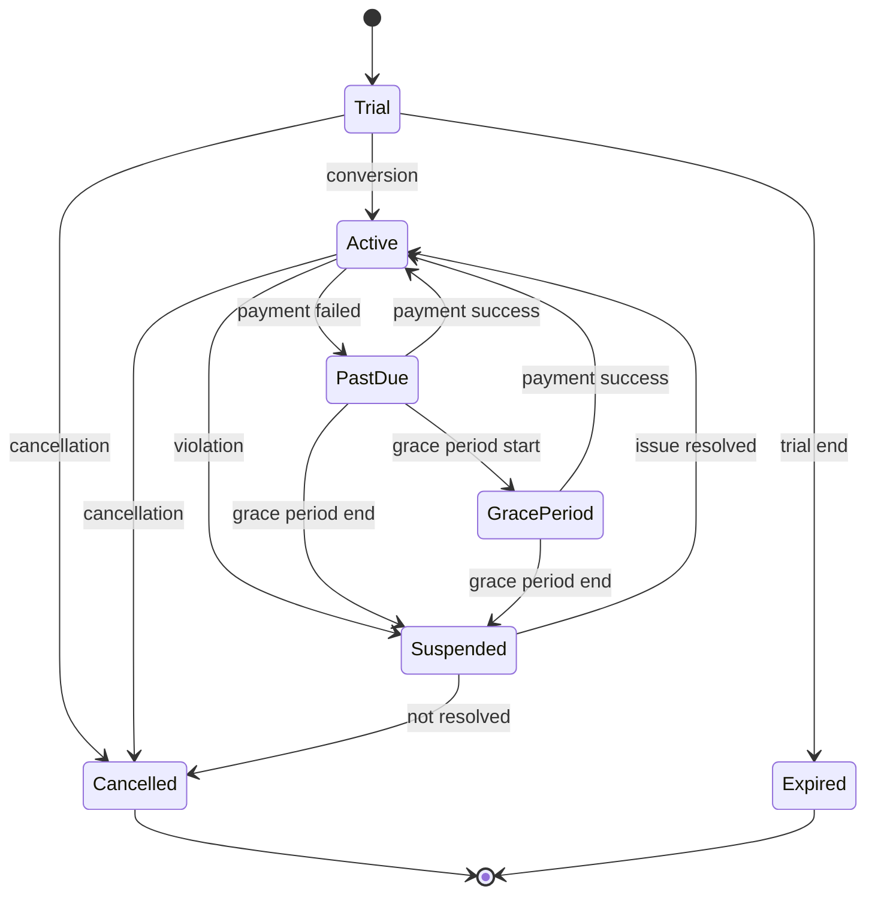

# Subscription Plans and Entitlement Model

**Document ID:** SAAS-14.5  
**Stage:** 14  
**Status:** Recorded  
**Last Updated:** 2026-01-29

---

## 1. Overview

This document defines the subscription plan architecture and entitlement model for the ClickIT platform. It specifies how plans are structured, what entitlements they provide, and how entitlements are evaluated.

**Key Principles:**
- Flexible plan configuration
- Clear entitlement boundaries
- Graceful limit handling
- No silent data deletion
- Transparent usage visibility

---

## 2. Subscription Plan Model

### 2.1 Plan Structure

```typescript
interface SubscriptionPlan {
  id: string;
  name: string;
  description: string;
  status: 'active' | 'deprecated' | 'archived';
  
  // Pricing
  pricing: {
    basePrice: number;
    currency: string;
    billingCycle: 'monthly' | 'annual';
    annualDiscount?: number;
  };
  
  // Entitlements
  entitlements: {
    users: { limit: number; type: 'hard' | 'soft' };
    branches: { limit: number; type: 'hard' | 'soft' };
    modules: string[];
    storage: { limit: number; unit: 'GB'; type: 'hard' | 'soft' };
    automation: { limit: number; unit: 'executions/month'; type: 'hard' | 'soft' };
    ai: { limit: number; unit: 'requests/month'; type: 'hard' | 'soft' };
    api: { limit: number; unit: 'requests/month'; type: 'hard' | 'soft' };
    support: 'basic' | 'premium' | 'enterprise';
    dataRetention: { limit: number; unit: 'years' };
  };
  
  // Features
  features: {
    advancedAnalytics: boolean;
    customReports: boolean;
    apiAccess: boolean;
    webhooks: boolean;
    sso: boolean;
    auditLogs: boolean;
    customBranding: boolean;
  };
  
  // Metadata
  createdAt: Date;
  updatedAt: Date;
  sortOrder: number;
}
```

### 2.2 Example Plans

**Free Plan:**
```typescript
const freePlan: SubscriptionPlan = {
  id: 'free',
  name: 'Free',
  description: 'Get started with basic features',
  pricing: {
    basePrice: 0,
    currency: 'USD',
    billingCycle: 'monthly',
  },
  entitlements: {
    users: { limit: 3, type: 'soft' },
    branches: { limit: 1, type: 'hard' },
    modules: ['crm', 'tasks'],
    storage: { limit: 1, unit: 'GB', type: 'soft' },
    automation: { limit: 100, unit: 'executions/month', type: 'hard' },
    ai: { limit: 50, unit: 'requests/month', type: 'hard' },
    api: { limit: 1000, unit: 'requests/month', type: 'hard' },
    support: 'basic',
    dataRetention: { limit: 1, unit: 'years' },
  },
  features: {
    advancedAnalytics: false,
    customReports: false,
    apiAccess: true,
    webhooks: false,
    sso: false,
    auditLogs: false,
    customBranding: false,
  },
};
```

**Professional Plan:**
```typescript
const professionalPlan: SubscriptionPlan = {
  id: 'professional',
  name: 'Professional',
  description: 'For growing businesses',
  pricing: {
    basePrice: 49,
    currency: 'USD',
    billingCycle: 'monthly',
    annualDiscount: 20,
  },
  entitlements: {
    users: { limit: 25, type: 'soft' },
    branches: { limit: 5, type: 'soft' },
    modules: ['crm', 'sales', 'inventory', 'finance', 'projects', 'tasks'],
    storage: { limit: 50, unit: 'GB', type: 'soft' },
    automation: { limit: 10000, unit: 'executions/month', type: 'soft' },
    ai: { limit: 5000, unit: 'requests/month', type: 'soft' },
    api: { limit: 100000, unit: 'requests/month', type: 'soft' },
    support: 'premium',
    dataRetention: { limit: 5, unit: 'years' },
  },
  features: {
    advancedAnalytics: true,
    customReports: true,
    apiAccess: true,
    webhooks: true,
    sso: false,
    auditLogs: true,
    customBranding: false,
  },
};
```

**Enterprise Plan:**
```typescript
const enterprisePlan: SubscriptionPlan = {
  id: 'enterprise',
  name: 'Enterprise',
  description: 'For large organizations',
  pricing: {
    basePrice: 0,  // Custom pricing
    currency: 'USD',
    billingCycle: 'annual',
  },
  entitlements: {
    users: { limit: -1, type: 'soft' },  // Unlimited
    branches: { limit: -1, type: 'soft' },
    modules: ['*'],  // All modules
    storage: { limit: -1, unit: 'GB', type: 'soft' },
    automation: { limit: -1, unit: 'executions/month', type: 'soft' },
    ai: { limit: -1, unit: 'requests/month', type: 'soft' },
    api: { limit: -1, unit: 'requests/month', type: 'soft' },
    support: 'enterprise',
    dataRetention: { limit: 10, unit: 'years' },
  },
  features: {
    advancedAnalytics: true,
    customReports: true,
    apiAccess: true,
    webhooks: true,
    sso: true,
    auditLogs: true,
    customBranding: true,
  },
};
```

---

## 3. Entitlement Evaluation

### 3.1 Entitlement Check

```typescript
interface EntitlementCheck {
  allowed: boolean;
  reason?: string;
  currentUsage?: number;
  limit?: number;
  remaining?: number;
}

async function checkEntitlement(
  organizationId: string,
  entitlement: string,
  additionalAmount: number = 1
): Promise<EntitlementCheck> {
  // Get subscription
  const subscription = await getActiveSubscription(organizationId);
  if (!subscription) {
    return { allowed: false, reason: 'No active subscription' };
  }
  
  // Get plan
  const plan = await getPlan(subscription.planId);
  
  // Get current usage
  const currentUsage = await getCurrentUsage(organizationId, entitlement);
  
  // Get limit
  const limit = plan.entitlements[entitlement].limit;
  
  // Check if unlimited
  if (limit === -1) {
    return {
      allowed: true,
      currentUsage,
      limit: -1,
    };
  }
  
  // Check if within limit
  const remaining = limit - currentUsage;
  const allowed = currentUsage + additionalAmount <= limit;
  
  return {
    allowed,
    reason: allowed ? undefined : 'Limit exceeded',
    currentUsage,
    limit,
    remaining: Math.max(0, remaining),
  };
}
```

### 3.2 Limit Types

**Hard Limits:**
- Cannot exceed limit
- Operation blocked when limit reached
- User must upgrade or reduce usage
- Example: API requests per month

**Soft Limits:**
- Can exceed limit with warning
- User notified when approaching limit
- Grace period before enforcement
- Example: User count

**No Limits:**
- Unlimited usage
- Represented as -1
- Example: Enterprise plan features

### 3.3 Limit Enforcement

**When Limit Reached:**
```typescript
async function enforceLimit(
  organizationId: string,
  entitlement: string,
  check: EntitlementCheck
): Promise<void> {
  if (check.allowed) {
    return;  // Within limit
  }
  
  const plan = await getPlanForOrganization(organizationId);
  const limitType = plan.entitlements[entitlement].type;
  
  if (limitType === 'hard') {
    // Block operation
    throw new LimitExceededError({
      entitlement,
      currentUsage: check.currentUsage,
      limit: check.limit,
      message: `Limit exceeded for ${entitlement}. Please upgrade your plan.`,
    });
  }
  
  if (limitType === 'soft') {
    // Allow with warning
    await sendLimitWarning(organizationId, entitlement, check);
    return;
  }
}
```

---

## 4. Subscription Lifecycle

### 4.1 Subscription States



### 4.2 Subscription Transitions

**Trial → Active:**
- Trigger: User subscribes to paid plan
- Actions: Create subscription, process payment
- Conditions: Payment successful

**Active → PastDue:**
- Trigger: Payment failed
- Actions: Notify user, start grace period
- Conditions: Payment retry failed

**PastDue → Active:**
- Trigger: Payment successful
- Actions: Update subscription status
- Conditions: Payment received

**PastDue → GracePeriod:**
- Trigger: Grace period started
- Actions: Restrict features, notify user
- Conditions: Configured grace period

**GracePeriod → Suspended:**
- Trigger: Grace period expired
- Actions: Suspend organization
- Conditions: Payment not received

**Active → Cancelled:**
- Trigger: User cancels subscription
- Actions: Set cancellation date, continue access
- Conditions: User authorization

**Cancelled → [*]:**
- Trigger: Cancellation date reached
- Actions: Close subscription, offer data export
- Conditions: Cancellation date passed

---

## 5. Entitlement Evaluation Model

### 5.1 Evaluation Logic

```typescript
async function evaluateEntitlement(
  userId: string,
  organizationId: string,
  action: string,
  resource: string
): Promise<EvaluationResult> {
  // 1. Check user authorization
  const userAuth = await checkUserAuthorization(userId, action, resource);
  if (!userAuth.allowed) {
    return { allowed: false, reason: 'User not authorized' };
  }
  
  // 2. Check subscription entitlement
  const subEntitlement = await checkSubscriptionEntitlement(
    organizationId,
    action,
    resource
  );
  if (!subEntitlement.allowed) {
    return { allowed: false, reason: 'Subscription does not include this feature' };
  }
  
  // 3. Check usage limits
  const usageCheck = await checkUsageLimits(organizationId, action);
  if (!usageCheck.allowed) {
    return { allowed: false, reason: 'Usage limit exceeded' };
  }
  
  // 4. All checks passed
  return { allowed: true };
}
```

### 5.2 Entitlement Conflicts

**Scenario 1: User has permission, subscription doesn't include feature**
- Result: Feature not available
- Message: "This feature is not included in your subscription"

**Scenario 2: Subscription includes feature, user lacks permission**
- Result: Feature not available to user
- Message: "You don't have permission to access this feature"

**Scenario 3: Both user and subscription allow, but limit exceeded**
- Result: Operation blocked (hard limit) or warning (soft limit)
- Message: "Usage limit exceeded. Please upgrade or reduce usage."

---

## 6. Acceptance Criteria

### 6.1 Subscription Plans

- [ ] Plans can be defined with entitlements
- [ ] Plans can be activated/deprecated
- [ ] Plan pricing configurable
- [ ] Plan features configurable
- [ ] Plans can be compared

### 6.2 Entitlement Evaluation

- [ ] Entitlements checked on every operation
- [ ] User authorization enforced
- [ ] Subscription entitlement enforced
- [ ] Usage limits enforced
- [ ] Clear error messages when limits exceeded

### 6.3 Limit Handling

- [ ] Hard limits block operations
- [ ] Soft limits warn but allow
- [ ] Users notified when approaching limits
- [ ] Usage visible to users
- [ ] Upgrade path clear

---

## 7. References

- Stage 7: Security Architecture (authorization)
- Stage 12: Deployment and Operations (billing)
- Stage 13: Product Strategy (MVP scope)

---

**Document Status:** Recorded  
**Owner:** Product Manager / Billing Specialist
