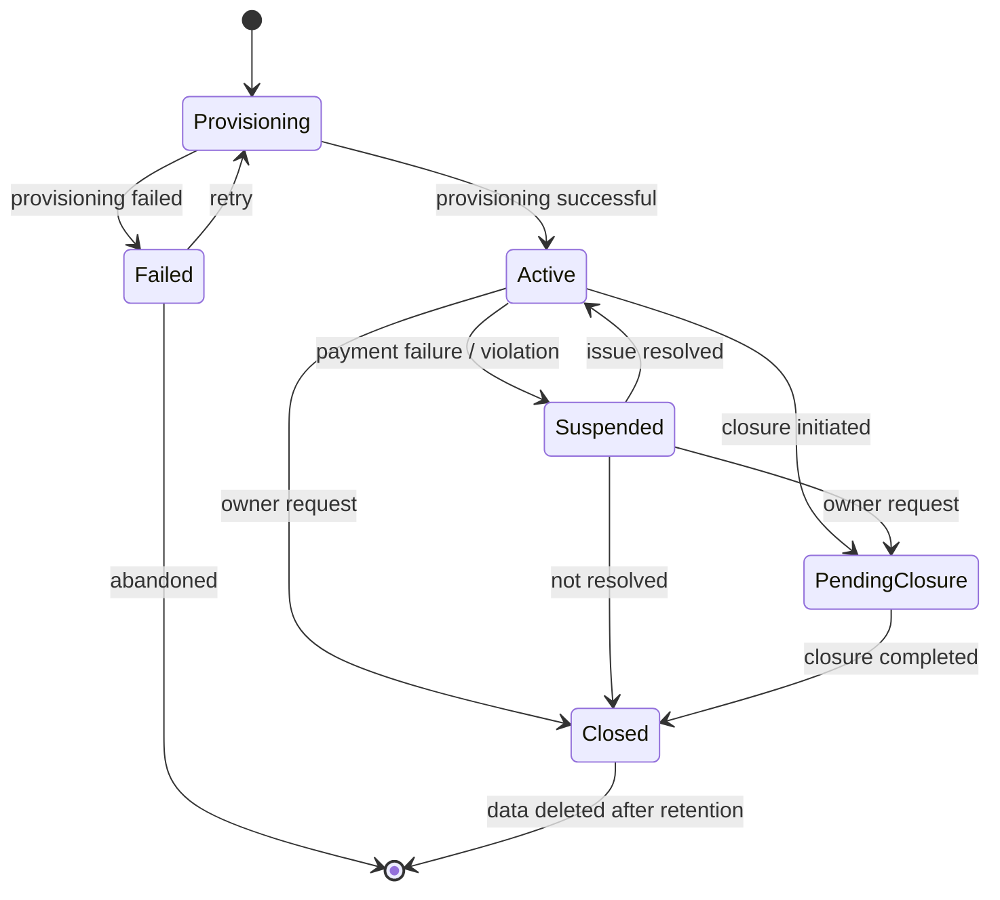

# Tenant Provisioning and Lifecycle Specification

**Document ID:** SAAS-14.3  
**Stage:** 14 — User Onboarding, Organization Setup, Tenant Provisioning, Subscriptions, Billing, and SaaS Administration  
**Status:** Recorded  
**Last Updated:** 2026-01-29

---

## 1. Overview

This document defines the technical process of tenant provisioning and the complete tenant lifecycle from creation through closure. It specifies how organizations are technically established in the platform, how resources are allocated, and how the lifecycle is managed.

**Key Principles:**
- Idempotent provisioning (no duplicates)
- Atomic operations where possible
- Clear state transitions
- Comprehensive audit trail
- Graceful failure handling
- Secure tenant isolation from creation

---

## 2. Tenant Provisioning Process

### 2.1 Provisioning Workflow

```
1. Organization Creation Request
   ↓
2. Validate Request
   ↓
3. Create Tenant Record
   ↓
4. Initialize Tenant Resources
   ↓
5. Create Initial Membership
   ↓
6. Apply Default Configuration
   ↓
7. Create Initial Audit Events
   ↓
8. Activate Tenant
   ↓
9. Notify User
```

### 2.2 Step 1: Organization Creation Request

**Request Sources:**
- User self-registration (new organization)
- Invitation acceptance (join existing)
- Platform admin creation (support/manual)
- API integration (automated provisioning)

**Request Payload:**
```typescript
interface TenantCreationRequest {
  // Organization details
  name: string;
  slug: string;
  industryId?: string;
  customIndustry?: {
    name: string;
    description: string;
  };
  
  // Regional settings
  country: string;
  timezone: string;
  currency: string;
  language: string;
  
  // Owner information
  ownerUserId: string;
  ownerEmail: string;
  
  // Initial configuration
  modules: string[];
  configuration?: Record<string, any>;
  
  // Subscription (if applicable)
  subscriptionPlanId?: string;
  trialDays?: number;
  
  // Metadata
  source: 'self_registration' | 'invitation' | 'admin' | 'api';
  requestId: string;  // For idempotency
}
```

**Validation:**
- Organization name uniqueness
- Slug uniqueness and format
- Valid country, timezone, currency, language codes
- Valid owner user ID
- Valid subscription plan (if provided)
- Request ID not already processed (idempotency)

### 2.3 Step 2: Validate Request

**Validation Checks:**
```typescript
async function validateTenantCreationRequest(
  request: TenantCreationRequest
): Promise<ValidationResult> {
  const errors: string[] = [];
  
  // Check organization name uniqueness
  const existingOrg = await db.organization.findUnique({
    where: { name: request.name }
  });
  if (existingOrg) {
    errors.push('Organization name already exists');
  }
  
  // Check slug uniqueness and format
  if (!isValidSlug(request.slug)) {
    errors.push('Invalid slug format');
  }
  const existingSlug = await db.organization.findUnique({
    where: { slug: request.slug }
  });
  if (existingSlug) {
    errors.push('Slug already exists');
  }
  
  // Validate regional settings
  if (!isValidCountry(request.country)) {
    errors.push('Invalid country code');
  }
  if (!isValidTimezone(request.timezone)) {
    errors.push('Invalid timezone');
  }
  if (!isValidCurrency(request.currency)) {
    errors.push('Invalid currency code');
  }
  if (!isValidLanguage(request.language)) {
    errors.push('Invalid language code');
  }
  
  // Validate owner
  const owner = await db.user.findUnique({
    where: { id: request.ownerUserId }
  });
  if (!owner) {
    errors.push('Owner user not found');
  }
  
  // Check idempotency
  const existingRequest = await db.provisioningRequest.findUnique({
    where: { requestId: request.requestId }
  });
  if (existingRequest) {
    return {
      valid: false,
      duplicate: true,
      existingTenantId: existingRequest.organizationId,
    };
  }
  
  return {
    valid: errors.length === 0,
    errors,
  };
}
```

### 2.4 Step 3: Create Tenant Record

**Tenant Creation:**
```typescript
async function createTenantRecord(
  request: TenantCreationRequest
): Promise<Organization> {
  const organization = await db.organization.create({
    data: {
      name: request.name,
      slug: request.slug,
      status: 'provisioning',
      industryId: request.industryId,
      customIndustry: request.customIndustry,
      country: request.country,
      timezone: request.timezone,
      currency: request.currency,
      language: request.language,
      ownerId: request.ownerUserId,
      createdAt: new Date(),
      updatedAt: new Date(),
    },
  });
  
  // Record provisioning request for idempotency
  await db.provisioningRequest.create({
    data: {
      requestId: request.requestId,
      organizationId: organization.id,
      status: 'in_progress',
      createdAt: new Date(),
    },
  });
  
  return organization;
}
```

**Tenant Record Fields:**
- `id`: UUID (primary key)
- `name`: Organization name
- `slug`: URL-safe unique identifier
- `status`: provisioning | active | suspended | closed
- `industryId`: Reference to industry (if predefined)
- `customIndustry`: JSON (if custom industry)
- `country`: ISO country code
- `timezone`: IANA timezone
- `currency`: ISO 4217 currency code
- `language`: BCP 47 language tag
- `ownerId`: Reference to owner user
- `createdAt`: Creation timestamp
- `updatedAt`: Last update timestamp

### 2.5 Step 4: Initialize Tenant Resources

**Resource Initialization:**
```typescript
async function initializeTenantResources(
  organization: Organization
): Promise<void> {
  // Create tenant-specific database schema (if using schema-per-tenant)
  // Or ensure RLS policies are in place (if using shared schema)
  
  // Initialize tenant storage
  await initializeTenantStorage(organization.id);
  
  // Create default roles
  await createDefaultRoles(organization.id);
  
  // Create default permissions
  await createDefaultPermissions(organization.id);
  
  // Initialize audit log table
  await initializeAuditLog(organization.id);
  
  // Create default configuration
  await createDefaultConfiguration(organization);
  
  // Initialize usage counters
  await initializeUsageCounters(organization.id);
}
```

**Resource Initialization Checklist:**
- [ ] Database schema/RLS policies configured
- [ ] Tenant storage initialized
- [ ] Default roles created
- [ ] Default permissions created
- [ ] Audit log initialized
- [ ] Default configuration applied
- [ ] Usage counters initialized
- [ ] Cache namespaces created
- [ ] Queue namespaces created

### 2.6 Step 5: Create Initial Membership

**Owner Membership:**
```typescript
async function createOwnerMembership(
  organization: Organization,
  ownerUserId: string
): Promise<Membership> {
  // Create membership
  const membership = await db.membership.create({
    data: {
      userId: ownerUserId,
      organizationId: organization.id,
      role: 'owner',
      status: 'active',
      joinedAt: new Date(),
    },
  });
  
  // Assign owner role
  const ownerRole = await db.role.findFirst({
    where: {
      organizationId: organization.id,
      name: 'owner',
    },
  });
  
  await db.membershipRole.create({
    data: {
      membershipId: membership.id,
      roleId: ownerRole.id,
    },
  });
  
  return membership;
}
```

**Membership Record:**
- `id`: UUID
- `userId`: Reference to user
- `organizationId`: Reference to organization
- `role`: owner | admin | member
- `status`: active | suspended | removed
- `joinedAt`: Join timestamp
- `updatedAt`: Last update timestamp

### 2.7 Step 6: Apply Default Configuration

**Default Configuration:**
```typescript
async function createDefaultConfiguration(
  organization: Organization
): Promise<void> {
  // Get industry profile (if predefined)
  let industryConfig = {};
  if (organization.industryId) {
    industryConfig = await getIndustryConfiguration(organization.industryId);
  } else if (organization.customIndustry) {
    // Suggest configuration for custom industry
    industryConfig = await suggestCustomIndustryConfiguration(
      organization.customIndustry.name,
      organization.customIndustry.description
    );
  }
  
  // Create organization configuration
  await db.organizationConfiguration.create({
    data: {
      organizationId: organization.id,
      terminology: industryConfig.terminology || {},
      modules: industryConfig.modules || ['crm', 'tasks', 'documents'],
      workflows: industryConfig.workflows || [],
      kpis: industryConfig.kpis || [],
      regional: {
        country: organization.country,
        timezone: organization.timezone,
        currency: organization.currency,
        language: organization.language,
      },
      createdAt: new Date(),
      updatedAt: new Date(),
    },
  });
}
```

### 2.8 Step 7: Create Initial Audit Events

**Initial Audit Events:**
```typescript
async function createInitialAuditEvents(
  organization: Organization,
  request: TenantCreationRequest
): Promise<void> {
  const events = [
    {
      eventType: 'organization.created',
      actor: { type: 'system' },
      action: { type: 'create', resource: 'organization' },
      context: {
        source: request.source,
        requestId: request.requestId,
      },
    },
    {
      eventType: 'organization.configured',
      actor: { type: 'system' },
      action: { type: 'configure', resource: 'organization' },
      context: {
        industry: organization.industryId || 'custom',
        modules: organization.configuration.modules,
      },
    },
    {
      eventType: 'membership.created',
      actor: { type: 'system' },
      action: { type: 'create', resource: 'membership' },
      context: {
        userId: request.ownerUserId,
        role: 'owner',
      },
    },
  ];
  
  for (const event of events) {
    await createAuditEvent(organization.id, event);
  }
}
```

### 2.9 Step 8: Activate Tenant

**Tenant Activation:**
```typescript
async function activateTenant(
  organization: Organization
): Promise<void> {
  await db.organization.update({
    where: { id: organization.id },
    data: {
      status: 'active',
      activatedAt: new Date(),
      updatedAt: new Date(),
    },
  });
  
  // Update provisioning request
  await db.provisioningRequest.update({
    where: { requestId: organization.requestId },
    data: {
      status: 'completed',
      completedAt: new Date(),
    },
  });
  
  // Create activation audit event
  await createAuditEvent(organization.id, {
    eventType: 'organization.activated',
    actor: { type: 'system' },
    action: { type: 'activate', resource: 'organization' },
  });
}
```

### 2.10 Step 9: Notify User

**Notification:**
```typescript
async function notifyUserOfProvisioning(
  organization: Organization,
  ownerUserId: string
): Promise<void> {
  const user = await db.user.findUnique({
    where: { id: ownerUserId },
  });
  
  // Send welcome email
  await sendEmail({
    to: user.email,
    subject: `Welcome to ${organization.name} on ClickIT!`,
    template: 'organization-welcome',
    data: {
      organizationName: organization.name,
      dashboardUrl: `${APP_URL}/org/${organization.slug}`,
      gettingStartedUrl: `${APP_URL}/getting-started`,
    },
  });
  
  // Create in-app notification
  await createNotification({
    userId: ownerUserId,
    type: 'organization_created',
    title: 'Organization Created',
    message: `Your organization "${organization.name}" is ready to use.`,
    link: `/org/${organization.slug}`,
  });
}
```

---

## 3. Provisioning Failure Handling

### 3.1 Failure Scenarios

**Scenario 1: Partial Provisioning Failure**
- Some resources created, others failed
- Tenant in inconsistent state
- Requires cleanup or retry

**Scenario 2: Concurrent Provisioning**
- Multiple requests for same organization
- Idempotency prevents duplicates
- Returns existing tenant

**Scenario 3: Resource Exhaustion**
- Storage quota exceeded
- Database connection limit reached
- Requires retry or escalation

**Scenario 4: External Service Failure**
- Email service down
- Payment provider unavailable
- Requires retry or fallback

### 3.2 Failure Recovery

**Recovery Strategy:**
```typescript
async function handleProvisioningFailure(
  organization: Organization,
  error: Error
): Promise<void> {
  // Log failure
  await logProvisioningFailure(organization.id, error);
  
  // Attempt cleanup
  try {
    await cleanupPartialProvisioning(organization.id);
  } catch (cleanupError) {
    // Log cleanup failure
    await logCleanupFailure(organization.id, cleanupError);
  }
  
  // Update provisioning request
  await db.provisioningRequest.update({
    where: { organizationId: organization.id },
    data: {
      status: 'failed',
      errorMessage: error.message,
      failedAt: new Date(),
    },
  });
  
  // Notify admin
  await notifyAdminOfProvisioningFailure(organization.id, error);
  
  // Notify user
  await notifyUserOfProvisioningFailure(organization.ownerId, error);
}
```

**Cleanup Process:**
1. Identify partially created resources
2. Delete created resources in reverse order
3. Update provisioning request status
4. Notify administrators
5. Notify user with retry option

**Retry Process:**
1. User requests retry
2. System validates original request
3. System re-attempts provisioning
4. If successful, activate tenant
5. If failed again, escalate to support

### 3.3 Idempotency

**Idempotency Key:**
- Each provisioning request has unique `requestId`
- Request ID stored in `provisioning_requests` table
- Duplicate requests return existing tenant
- Prevents duplicate organizations

**Idempotency Check:**
```typescript
async function checkIdempotency(
  requestId: string
): Promise<{ isDuplicate: boolean; existingTenantId?: string }> {
  const existing = await db.provisioningRequest.findUnique({
    where: { requestId },
  });
  
  if (existing) {
    return {
      isDuplicate: true,
      existingTenantId: existing.organizationId,
    };
  }
  
  return { isDuplicate: false };
}
```

---

## 4. Tenant Lifecycle States

### 4.1 Lifecycle State Diagram



### 4.2 Tenant States

**Provisioning:**
- Tenant creation in progress
- Resources being allocated
- Not yet accessible to users
- Typical duration: < 1 minute

**Active:**
- Tenant fully provisioned
- Users can access and use platform
- Subscription active (if applicable)
- Normal operations

**Failed:**
- Provisioning failed
- Tenant not accessible
- Requires retry or manual intervention
- Cleanup in progress or completed

**Suspended:**
- Tenant temporarily disabled
- Users cannot access platform
- Data preserved
- Can be reactivated

**PendingClosure:**
- Closure process initiated
- Data export in progress
- Access restricted
- Awaiting final confirmation

**Closed:**
- Tenant fully closed
- Access revoked
- Data in retention period
- Awaiting deletion per policy

### 4.3 State Transitions

**Provisioning → Active:**
- Trigger: Provisioning successful
- Actions: Activate tenant, notify user
- Conditions: All resources created successfully

**Provisioning → Failed:**
- Trigger: Provisioning error
- Actions: Log error, cleanup, notify
- Conditions: Critical resource creation failed

**Active → Suspended:**
- Trigger: Payment failure, policy violation, admin action
- Actions: Disable access, notify user, log event
- Conditions: Suspension criteria met

**Active → PendingClosure:**
- Trigger: Owner requests closure
- Actions: Begin closure process, offer data export
- Conditions: Owner authorization verified

**Suspended → Active:**
- Trigger: Issue resolved (payment made, violation corrected)
- Actions: Re-enable access, notify user
- Conditions: Suspension criteria no longer met

**Suspended → Closed:**
- Trigger: Suspension not resolved within grace period
- Actions: Begin closure process
- Conditions: Grace period expired

**PendingClosure → Closed:**
- Trigger: Closure process completed
- Actions: Finalize closure, start retention period
- Conditions: Data export completed, confirmations received

**Closed → [*]:**
- Trigger: Retention period expired
- Actions: Delete all tenant data
- Conditions: Retention period complete, no legal holds

---

## 5. Tenant Suspension and Reactivation

### 5.1 Suspension Triggers

**Payment Failure:**
- Subscription payment failed
- Grace period expired
- Automatic suspension

**Policy Violation:**
- Terms of service violation
- Acceptable use policy violation
- Legal compliance issue
- Manual suspension by platform admin

**Security Issue:**
- Suspected compromise
- Abusive behavior
- Manual suspension by platform admin

**Administrative Action:**
- Owner requests temporary suspension
- Platform admin suspends for maintenance
- Manual suspension

### 5.2 Suspension Process

**Suspension Workflow:**
```typescript
async function suspendTenant(
  organizationId: string,
  reason: SuspensionReason,
  suspendedBy: string
): Promise<void> {
  // Update tenant status
  await db.organization.update({
    where: { id: organizationId },
    data: {
      status: 'suspended',
      suspendedAt: new Date(),
      suspensionReason: reason,
      suspendedBy: suspendedBy,
    },
  });
  
  // Revoke all active sessions
  await revokeAllSessions(organizationId);
  
  // Disable API access
  await disableAPIAccess(organizationId);
  
  // Notify owner
  await notifyOwnerOfSuspension(organizationId, reason);
  
  // Notify users
  await notifyUsersOfSuspension(organizationId, reason);
  
  // Log suspension
  await createAuditEvent(organizationId, {
    eventType: 'organization.suspended',
    actor: { type: 'user', id: suspendedBy },
    action: { type: 'suspend', resource: 'organization' },
    context: { reason },
  });
}
```

**Suspension Effects:**
- Users cannot log in
- API access disabled
- Webhooks paused
- Background jobs paused
- Data preserved but inaccessible
- Billing continues (if applicable)

### 5.3 Reactivation Process

**Reactivation Workflow:**
```typescript
async function reactivateTenant(
  organizationId: string,
  reactivatedBy: string
): Promise<void> {
  // Update tenant status
  await db.organization.update({
    where: { id: organizationId },
    data: {
      status: 'active',
      suspendedAt: null,
      suspensionReason: null,
      reactivatedAt: new Date(),
      reactivatedBy: reactivatedBy,
    },
  });
  
  // Re-enable API access
  await enableAPIAccess(organizationId);
  
  // Resume background jobs
  await resumeBackgroundJobs(organizationId);
  
  // Notify owner
  await notifyOwnerOfReactivation(organizationId);
  
  // Notify users
  await notifyUsersOfReactivation(organizationId);
  
  // Log reactivation
  await createAuditEvent(organizationId, {
    eventType: 'organization.reactivated',
    actor: { type: 'user', id: reactivatedBy },
    action: { type: 'reactivate', resource: 'organization' },
  });
}
```

**Reactivation Conditions:**
- Suspension reason resolved
- Payment updated (if payment failure)
- Violation corrected (if policy violation)
- Security issue addressed (if security issue)
- Owner or admin authorization

---

## 6. Tenant Closure and Deletion

### 6.1 Closure Process

**Closure Workflow:**
```
1. Owner requests closure
   ↓
2. Confirm closure intent
   ↓
3. Offer data export
   ↓
4. Export data (if requested)
   ↓
5. Confirm closure
   ↓
6. Begin closure process
   ↓
7. Revoke all access
   ↓
8. Cancel subscriptions
   ↓
9. Stop background jobs
   ↓
10. Enter retention period
    ↓
11. Delete data after retention
```

**Closure Confirmation:**
```typescript
async function initiateTenantClosure(
  organizationId: string,
  ownerUserId: string
): Promise<ClosureInitiation> {
  // Verify owner
  const owner = await verifyOrganizationOwner(organizationId, ownerUserId);
  if (!owner) {
    throw new Error('Only organization owner can initiate closure');
  }
  
  // Update status
  await db.organization.update({
    where: { id: organizationId },
    data: {
      status: 'pending_closure',
      closureInitiatedAt: new Date(),
      closureInitiatedBy: ownerUserId,
    },
  });
  
  // Offer data export
  const exportToken = await generateDataExportToken(organizationId);
  
  // Notify owner
  await notifyOwnerOfClosureInitiation(organizationId, exportToken);
  
  return {
    organizationId,
    exportToken,
    closureDeadline: addDays(new Date(), 30),  // 30 days to confirm
  };
}
```

### 6.2 Data Export

**Export Options:**
- Full data export (all modules)
- Selective export (specific modules)
- Format: JSON, CSV, PDF
- Includes: All business data, audit logs, configurations
- Excludes: System metadata, platform data

**Export Process:**
```typescript
async function exportTenantData(
  organizationId: string,
  options: ExportOptions
): Promise<ExportResult> {
  // Generate export
  const exportJob = await createExportJob(organizationId, options);
  
  // Wait for completion
  await waitForExportCompletion(exportJob.id);
  
  // Generate download link
  const downloadUrl = await generateSecureDownloadLink(
    exportJob.id,
    expiresAt: addHours(new Date(), 24)
  );
  
  return {
    exportJobId: exportJob.id,
    downloadUrl,
    expiresAt: addHours(new Date(), 24),
    size: exportJob.size,
    format: options.format,
  };
}
```

### 6.3 Data Retention and Deletion

**Retention Policy:**
- Data retained for 90 days after closure
- Owner can request immediate deletion (if no legal holds)
- Legal holds prevent deletion
- After retention period, data permanently deleted

**Deletion Process:**
```typescript
async function deleteTenantData(
  organizationId: string
): Promise<void> {
  // Check for legal holds
  const legalHolds = await getLegalHolds(organizationId);
  if (legalHolds.length > 0) {
    throw new Error('Cannot delete: legal holds in place');
  }
  
  // Delete all tenant data
  await db.$transaction([
    // Delete business data
    db.lead.deleteMany({ where: { organizationId } }),
    db.contact.deleteMany({ where: { organizationId } }),
    db.opportunity.deleteMany({ where: { organizationId } }),
    // ... all other tables
    
    // Delete configuration
    db.organizationConfiguration.delete({ where: { organizationId } }),
    
    // Delete memberships
    db.membership.deleteMany({ where: { organizationId } }),
    
    // Delete roles and permissions
    db.role.deleteMany({ where: { organizationId } }),
    
    // Delete audit logs (or archive per policy)
    db.auditLog.deleteMany({ where: { organizationId } }),
    
    // Delete organization
    db.organization.delete({ where: { id: organizationId } }),
  ]);
  
  // Delete tenant storage
  await deleteTenantStorage(organizationId);
  
  // Delete tenant cache
  await deleteTenantCache(organizationId);
  
  // Log deletion
  await logTenantDeletion(organizationId);
}
```

---

## 7. Ownership Transfer

### 7.1 Transfer Process

**Transfer Workflow:**
```typescript
async function transferOwnership(
  organizationId: string,
  currentOwnerId: string,
  newOwnerId: string
): Promise<void> {
  // Verify current owner
  const currentOwner = await verifyOrganizationOwner(
    organizationId,
    currentOwnerId
  );
  if (!currentOwner) {
    throw new Error('Current owner verification failed');
  }
  
  // Verify new owner is member
  const newOwnerMembership = await db.membership.findFirst({
    where: {
      organizationId,
      userId: newOwnerId,
      status: 'active',
    },
  });
  if (!newOwnerMembership) {
    throw new Error('New owner must be organization member');
  }
  
  // Transfer ownership
  await db.organization.update({
    where: { id: organizationId },
    data: { ownerId: newOwnerId },
  });
  
  // Update memberships
  await db.membership.update({
    where: {
      organizationId,
      userId: currentOwnerId,
    },
    data: { role: 'admin' },  // Demote current owner to admin
  });
  
  await db.membership.update({
    where: {
      organizationId,
      userId: newOwnerId,
    },
    data: { role: 'owner' },  // Promote new owner
  });
  
  // Log transfer
  await createAuditEvent(organizationId, {
    eventType: 'organization.ownership_transferred',
    actor: { type: 'user', id: currentOwnerId },
    action: { type: 'transfer', resource: 'ownership' },
    context: {
      fromUserId: currentOwnerId,
      toUserId: newOwnerId,
    },
  });
  
  // Notify both parties
  await notifyOwnerOfTransfer(organizationId, currentOwnerId, newOwnerId);
  await notifyNewOwnerOfTransfer(organizationId, newOwnerId);
}
```

### 7.2 Transfer Conditions

**Requirements:**
- Current owner must authorize transfer
- New owner must be active member
- New owner must have appropriate permissions
- No pending closure or suspension
- No legal holds preventing transfer

**Restrictions:**
- Cannot transfer to external user (must be member first)
- Cannot transfer if only one member (must invite first)
- Cannot transfer during closure process
- Cannot transfer if legal holds in place

---

## 8. Provisioning Monitoring

### 8.1 Monitoring Metrics

**Provisioning Metrics:**
- Provisioning success rate
- Average provisioning time
- Provisioning failure rate
- Failure reasons distribution
- Retry rate

**Lifecycle Metrics:**
- Active tenants count
- Suspended tenants count
- Closure rate
- Reactivation rate
- Ownership transfer rate

**Performance Metrics:**
- Provisioning API latency
- Resource allocation time
- Configuration application time
- Notification delivery time

### 8.2 Alerting

**Critical Alerts:**
- Provisioning failure rate > 5%
- Provisioning time > 5 minutes
- Multiple provisioning failures for same user
- Resource exhaustion

**Warning Alerts:**
- Provisioning time > 2 minutes
- Provisioning failure rate > 2%
- Unusual provisioning patterns

**Informational Alerts:**
- Provisioning completed
- Tenant suspended
- Tenant closed
- Ownership transferred

---

## 9. Acceptance Criteria

### 9.1 Provisioning

- [ ] Tenant creation is idempotent
- [ ] Provisioning completes successfully
- [ ] All resources allocated correctly
- [ ] Default configuration applied
- [ ] Initial audit events created
- [ ] User notified of completion

### 9.2 Failure Handling

- [ ] Provisioning failures handled gracefully
- [ ] Partial provisioning cleaned up
- [ ] Retry mechanism works
- [ ] Failures logged and monitored
- [ ] Users notified of failures

### 9.3 Lifecycle Management

- [ ] Tenant states transition correctly
- [ ] Suspension works as expected
- [ ] Reactivation restores access
- [ ] Closure process completes
- [ ] Data deletion follows retention policy

### 9.4 Ownership Transfer

- [ ] Ownership can be transferred
- [ ] Transfer requires authorization
- [ ] Transfer logged in audit trail
- [ ] Both parties notified
- [ ] Permissions updated correctly

---

## 10. References

- Stage 5: Data Model (organization entities)
- Stage 7: Security Architecture (tenant isolation)
- Stage 12: Deployment and Operations (provisioning)
- Stage 13: Product Strategy (MVP scope)

---

**Document Status:** Recorded  
**Next Review:** Before implementation  
**Owner:** Backend Lead / DevOps Lead
